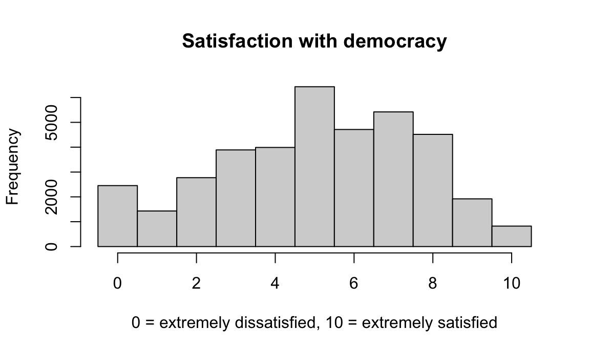
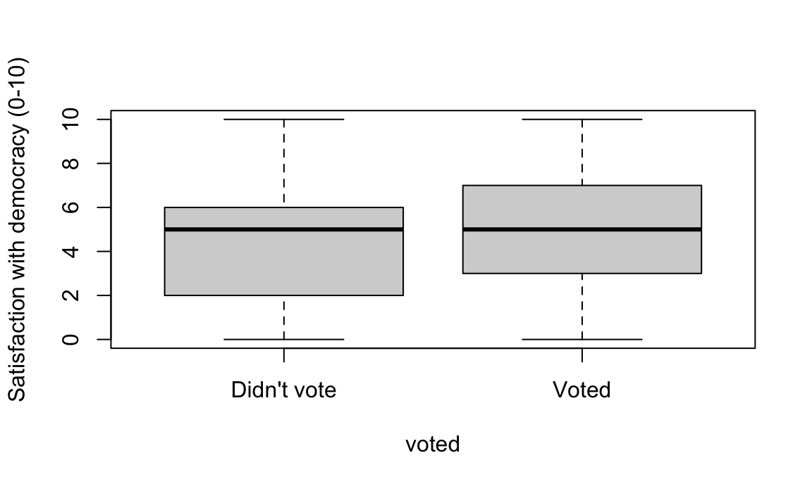
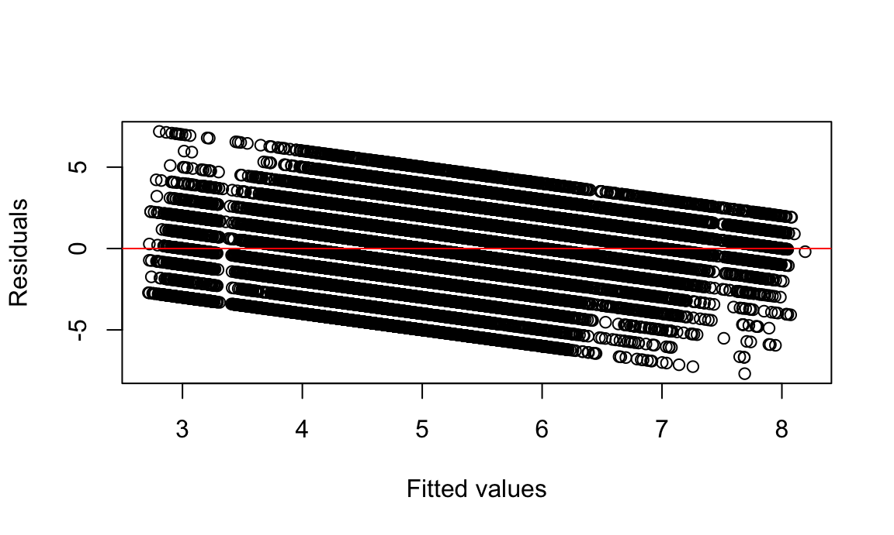

# Mock lab exam

Practice exam in the style of the lab exercises: ESS round 11, satisfaction with democracy, voting and political interest. Work in your own script first, then open the solutions.

> **NOTE:**
>
> - This is **not** the real exam; nobody has seen that yet. The tasks follow the lab exercises (Labs 2–5) with variables the labs didn’t use.
> - Set a timer for 90 minutes. Work in your own project, in a script named `Lastname_Firstname_mock.R`.
> - Write a `# Interpretation:` comment in your own words after every result.
> - Then open the solutions and compare. The numbers should match; your sentences don’t need to.

## The data

The European Social Survey, round 11 (`ess.csv` from the labs). Each row is one respondent.

| Variable | Question | Codes |
|----|----|----|
| `stfdem` | How satisfied with the way democracy works in your country? | 0 = extremely dissatisfied … 10 = extremely satisfied; 77, 88, 99 = missing |
| `vote` | Voted in the last national election? | 1 = yes, 2 = no, 3 = not eligible to vote; 7, 8, 9 = missing |
| `polintr` | How interested in politics? | 1 = very, 2 = quite, 3 = hardly, 4 = not at all interested; 7, 8, 9 = missing |
| `agea` | Age | 999 = missing |
| `gndr` | Gender | 1 = male, 2 = female |
| `eduyrs` | Years of full-time education | 77, 88, 99 = missing |
| `cntry` | Country | two-letter code |

## Tasks

1.  **Clean** `stfdem` into `swd` (0–10), `vote` into `voted` (1 = voted, 0 = didn’t vote; not eligible and the missing codes become `NA`), and `polintr` into `interested` (1 = very or quite interested, 0 = hardly or not at all). Also clean `agea` and `eduyrs`. Check every new variable.
2.  **Describe** `swd`: mean, median, standard deviation and a histogram. What percentage of respondents voted?
3.  Is political interest **associated** with voting? Give the percentages and the test.
4.  Is satisfaction with democracy **different** for voters and non-voters?
5.  What is the **correlation** between satisfaction with democracy and years of education?
6.  Estimate an **OLS regression** of `swd` on age, gender, education, `interested` and country fixed effects. Interpret the coefficients and the R².
7.  Test the OLS model for **heteroskedasticity** and **multicollinearity**.
8.  Estimate a **logistic regression** of `voted` on `swd`, age, gender, education and country fixed effects. Calculate the **marginal effects** and interpret the one for `swd`.
9.  Does the effect of education on `swd` **depend on** political interest? Estimate the OLS model from task 6 with an interaction between education and `interested`.

## Solutions

Open them only after you’ve tried.

> **TIP:**
>
> ``` r
> dataset <- read.csv("data/ess_lab.csv")   # in your project: read.csv("data/ess.csv")
>
> table(dataset$stfdem, useNA = "ifany")
> #> 
> #>    0    1    2    3    4    5    6    7    8    9   10   77   88   99 
> #> 2454 1432 2773 3891 3990 6434 4713 5420 4516 1920  824  123 1014   10
> dataset$swd <- ifelse(dataset$stfdem >= 0 & dataset$stfdem <= 10, dataset$stfdem, NA)
> table(dataset$swd, useNA = "ifany")
> #> 
> #>    0    1    2    3    4    5    6    7    8    9   10 <NA> 
> #> 2454 1432 2773 3891 3990 6434 4713 5420 4516 1920  824 1147
>
> table(dataset$vote, useNA = "ifany")
> #> 
> #>     1     2     3     7     8     9 
> #> 28577  7954  2669   128   164    22
> dataset$voted <- ifelse(dataset$vote == 1, 1, ifelse(dataset$vote == 2, 0, NA))
> table(dataset$vote, dataset$voted, useNA = "ifany")
> #>    
> #>         0     1  <NA>
> #>   1     0 28577     0
> #>   2  7954     0     0
> #>   3     0     0  2669
> #>   7     0     0   128
> #>   8     0     0   164
> #>   9     0     0    22
>
> table(dataset$polintr, useNA = "ifany")
> #> 
> #>     1     2     3     4     7     8     9 
> #>  4507 13035 13777  8137    21    31     6
> dataset$interested <- ifelse(dataset$polintr %in% c(1, 2), 1,
>                              ifelse(dataset$polintr %in% c(3, 4), 0, NA))
> table(dataset$polintr, dataset$interested, useNA = "ifany")
> #>    
> #>         0     1  <NA>
> #>   1     0  4507     0
> #>   2     0 13035     0
> #>   3 13777     0     0
> #>   4  8137     0     0
> #>   7     0     0    21
> #>   8     0     0    31
> #>   9     0     0     6
>
> dataset$age <- ifelse(dataset$agea == 999, NA, dataset$agea)
> dataset$edu <- ifelse(dataset$eduyrs %in% c(77, 88, 99), NA, dataset$eduyrs)
> summary(dataset$age); summary(dataset$edu)
> #>    Min. 1st Qu.  Median    Mean 3rd Qu.    Max.     NAs 
> #>   15.00   37.00   53.00   51.86   67.00   90.00     258
> #>    Min. 1st Qu.  Median    Mean 3rd Qu.    Max.     NAs 
> #>    0.00   11.00   13.00   13.19   16.00   69.00     494
> ```
>
> **The traps:**
>
> - `vote = 3` (“not eligible”) is not “didn’t vote”, so it becomes `NA`.
> - `polintr` runs backwards: **1** is the *most* interested.

> **TIP:**
>
> ``` r
> mean(dataset$swd, na.rm = TRUE)
> #> [1] 5.073292
> median(dataset$swd, na.rm = TRUE)
> #> [1] 5
> sd(dataset$swd, na.rm = TRUE)
> #> [1] 2.536929
> hist(dataset$swd, breaks = seq(-0.5, 10.5, by = 1),
>      main = "Satisfaction with democracy", xlab = "0 = extremely dissatisfied, 10 = extremely satisfied")
> ```
>
> [](mock-exam_files/figure-html/unnamed-chunk-3-1.png)
>
> ``` r
> round(prop.table(table(dataset$voted)) * 100, 1)
> #> 
> #>    0    1 
> #> 21.8 78.2
> ```
>
> > Mean: 5.07. Median: 5. Standard deviation: 2.54.
> >
> > Given that the mean and the median are very close, the distribution of satisfaction with democracy is approximately symmetric, around the middle of the 0-10 scale. The standard deviation means that values typically lie about 2.5 points from the mean, about half of the mean, so the spread of the distribution is fairly large.
> >
> > 78.2% of the eligible respondents who answered say they voted in the last national election.

> **TIP:**
>
> ``` r
> tab <- table(dataset$interested, dataset$voted)   # rows: interested, columns: voted
> tab
> #>    
> #>         0     1
> #>   0  6291 13568
> #>   1  1648 14976
> round(prop.table(tab, margin = 1) * 100, 1)       # % who voted within each interest group
> #>    
> #>        0    1
> #>   0 31.7 68.3
> #>   1  9.9 90.1
> chisq.test(tab)
> #> 
> #>  Pearson's Chi-squared test with Yates' continuity correction
> #> 
> #> data:  tab
> #> X-squared = 2516.5, df = 1, p-value < 2.2e-16
> ```
>
> > X² = 2516.5 (df = 1, p \< 0.001). The association is statistically significant at the 0.01 level, so we reject the null hypothesis of no association between political interest and voting. The chi-square test gives no direction, but the percentages do: 90% of the interested voted, against 68% of the uninterested.

> **TIP:**
>
> ``` r
> t.test(swd ~ voted, data = dataset)
> #> 
> #>  Welch Two Sample t-test
> #> 
> #> data:  swd by voted
> #> t = -24.518, df = 11635, p-value < 2.2e-16
> #> alternative hypothesis: true difference in means between group 0 and group 1 is not equal to 0
> #> 95 percent confidence interval:
> #>  -0.8773845 -0.7474807
> #> sample estimates:
> #> mean in group 0 mean in group 1 
> #>        4.362055        5.174488
> boxplot(swd ~ voted, data = dataset, names = c("Didn't vote", "Voted"),
>         ylab = "Satisfaction with democracy (0-10)")
> ```
>
> [](mock-exam_files/figure-html/unnamed-chunk-6-1.png)
>
> > Non-voters have a mean satisfaction of 4.36 and voters 5.17 (t = -24.52, p \< 0.001). The difference is statistically significant at the 0.01 level, so we reject the null hypothesis that the means are not different: voters are more satisfied with democracy. The scale runs the “normal” way (higher = more satisfied), unlike Lab 3’s satisfaction variable.

> **TIP:**
>
> ``` r
> cor(dataset$swd, dataset$edu, use = "complete.obs")
> #> [1] 0.09212951
> cor.test(dataset$swd, dataset$edu)
> #> 
> #>  Pearson's product-moment correlation
> #> 
> #> data:  dataset$swd and dataset$edu
> #> t = 18.015, df = 37913, p-value < 2.2e-16
> #> alternative hypothesis: true correlation is not equal to 0
> #> 95 percent confidence interval:
> #>  0.08213995 0.10210055
> #> sample estimates:
> #>        cor 
> #> 0.09212951
> ```
>
> > Correlation: 0.09. There is a positive, negligible association between satisfaction with democracy and education, so that the more educated someone is, the very slightly more satisfied with democracy they are. It is statistically significant at the 0.01 level because the sample is large, but a statistically significant association is not always a strong one.

> **TIP:**
>
> ``` r
> model1 <- lm(swd ~ age + factor(gndr) + edu + interested + factor(cntry), data = dataset)
> summary(model1)$coefficients[1:5, ]    # summary(model1) shows the full output
> #>                   Estimate   Std. Error    t value      Pr(>|t|)
> #> (Intercept)    5.506465804 0.0790066673 69.6962167  0.000000e+00
> #> age           -0.005758714 0.0006814444 -8.4507458  2.996843e-17
> #> factor(gndr)2  0.006423055 0.0245110365  0.2620475  7.932863e-01
> #> edu            0.018004171 0.0032675817  5.5099376  3.613063e-08
> #> interested     0.584120237 0.0262750207 22.2310096 8.648920e-109
> summary(model1)$r.squared
> #> [1] 0.1518039
> nobs(model1)
> #> [1] 37688
> ```
>
> > Net of the other variables and the country fixed effects:
> >
> > - When age increases by one year, satisfaction with democracy decreases by 0.0058 points (statistically significant at the 0.01 level), so about 0.06 points per decade: statistically significant, but small.
> > - Satisfaction is 0.006 points higher for women than for men, the reference category, but this is not statistically significant (p = 0.793): we cannot reject the null hypothesis of no effect of gender.
> > - When education increases by one year, satisfaction increases by 0.018 points (statistically significant at the 0.01 level).
> > - Satisfaction is 0.58 points higher for people interested in politics than for the uninterested (statistically significant at the 0.01 level), the largest effect in the model.
> >
> > R² = 0.152: the independent variables, including the country fixed effects, explain 15.2% of the variance of satisfaction with democracy (N = 37,688).

> **TIP:**
>
> ``` r
> plot(model1$fitted.values, model1$residuals, xlab = "Fitted values", ylab = "Residuals")
> abline(h = 0, col = "red")
> ```
>
> [](mock-exam_files/figure-html/unnamed-chunk-11-1.png)
>
> ``` r
> bptest(model1)
> #> 
> #>  studentized Breusch-Pagan test
> #> 
> #> data:  model1
> #> BP = 809.24, df = 26, p-value < 2.2e-16
> vif(model1)
> #>                   GVIF Df GVIF^(1/(2*Df))
> #> age           1.109625  1        1.053387
> #> factor(gndr)  1.032381  1        1.016061
> #> edu           1.197866  1        1.094471
> #> interested    1.181952  1        1.087176
> #> factor(cntry) 1.169766 22        1.003570
> ```
>
> > The Breusch-Pagan test rejects homoskedasticity (BP = 809, p \< 0.001), so there is heteroskedasticity: the variance of the residuals is not the same across the values of the dependent variable. The quick fix is to use robust standard errors. All the VIFs are close to 1 (largest 1.2), well below 10, so multicollinearity is not a concern.

> **TIP:**
>
> ``` r
> logit1 <- glm(voted ~ swd + age + factor(gndr) + edu + factor(cntry),
>               data = dataset, family = binomial)
> summary(logit1)$coefficients[1:5, ]
> #>                  Estimate   Std. Error    z value      Pr(>|z|)
> #> (Intercept)   -2.13798972 0.1031956824 -20.717821  2.392692e-95
> #> swd            0.10432730 0.0058308464  17.892309  1.353812e-71
> #> age            0.02859603 0.0008387938  34.091851 9.740861e-255
> #> factor(gndr)2 -0.13512217 0.0279408248  -4.836012  1.324699e-06
> #> edu            0.12375132 0.0042386094  29.196206 2.166649e-187
> summary(margins(logit1, variables = c("swd", "age", "gndr", "edu")))
> #>  factor     AME     SE       z      p   lower   upper
> #>     age  0.0043 0.0001 35.7395 0.0000  0.0040  0.0045
> #>     edu  0.0185 0.0006 30.1577 0.0000  0.0173  0.0197
> #>   gndr2 -0.0201 0.0041 -4.8541 0.0000 -0.0282 -0.0120
> #>     swd  0.0156 0.0009 18.1182 0.0000  0.0139  0.0173
> ```
>
> > The coefficient of `swd` is positive, so more satisfied people are more likely to have voted (logit coefficients cannot be interpreted beyond their sign). The marginal effect is 0.016: when satisfaction with democracy increases by one point, the probability of having voted increases by 1.6 percentage points (statistically significant at the 0.01 level), net of age, gender, education and the country fixed effects. When education increases by one year, it increases by 1.8 percentage points.
> >
> > This shows an association, not a cause: voting may also make people more satisfied.

> **TIP:**
>
> ``` r
> model_int <- lm(swd ~ age + factor(gndr) + edu * interested + factor(cntry), data = dataset)
> summary(model_int)$coefficients[c("edu", "interested", "edu:interested"), ]
> #>                  Estimate  Std. Error  t value     Pr(>|t|)
> #> edu            0.01257597 0.004389593 2.864952 4.173033e-03
> #> interested     0.43156745 0.086467190 4.991112 6.029994e-07
> #> edu:interested 0.01143150 0.006173020 1.851848 6.405541e-02
> coef(model_int)[["edu"]] + coef(model_int)[["edu:interested"]]   # education slope for the interested
> #> [1] 0.02400747
> ```
>
> > For the uninterested (the reference, `interested` = 0), each year of education raises satisfaction by 0.013 points. For the interested, by 0.013 + 0.011 = 0.024 points. The interaction is statistically significant at the 0.10 level (p = 0.064) but not at the 0.05 level, so the evidence that political interest moderates the effect of education is weak.

Back to top
