Lennart Klein

## R Recap Before the Lab Exam

Introduction to Quantitative Methods · Sciences Po

Lennart Klein · 19 November 2026

Unofficial: not official course material.

**Follow along:**
[quant1.kleinbutsignificant.com/slides.html](https://quant1.kleinbutsignificant.com/slides.html)
· [ PDF](slides.pdf)

## Today

**By the end you should have**

- an **RStudio** project you can reuse on Tuesday
- a feel for how R reads a line of code
- a routine for fixing errors, with or without AI

**The idea of this session**

- code along and interrupt with any questions
- everything builds on TAs’ labs and the lecture
- I am just a nerd who likes to share R \<3
- slides are recycled from my time as a TA

## 1 · Setting Up a Project

##  and RStudio

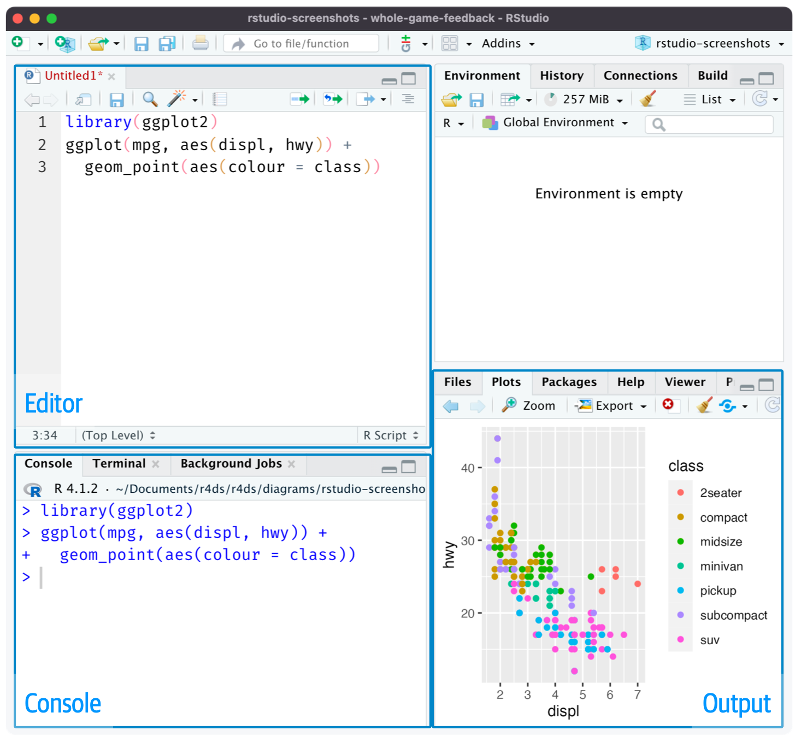

Figure: Wickham et al., [*R for Data Science*
(2e)](https://r4ds.hadley.nz/workflow-scripts.html), CC BY-NC-ND 3.0

**R** does the statistics. **RStudio** is where you write it.

- **Editor:** your script, the file you hand in
- **Console:** runs R. `>` ready, `+` unfinished line
- **Terminal:** not R, only for setup
- **Environment:** data objects & variables in memory
- **Output:** plots, help, files

## Best Practice: One folder per project

A good folder structure (example):

    labexam/
    ├── labexam.Rproj    ← double-click
    ├── data/
    │   ├── anes_….csv
    │   └── ess.csv
    ├── output/
    └── Lastname_Firstname.R

- In **RStudio**, create one with: *File \> New Project \> New
  Directory*.
- Opening `labexam.Rproj` automatically makes this folder the working
  directory.
- `read.csv("data/ess.csv")` then works on any computer, without
  `setwd()`.
- \[TIP\] Before you hand in: *Session \> Restart R*, then run the whole
  script again to make sure it works.

## Best Practice: Start every session from a clean slate

By default, **RStudio** saves everything in memory to `.RData` when you
quit and loads it again next time. Yesterday’s objects come back, and a
script can seem to work only because of them.

*Tools \> Global Options \> General*:

- untick **Restore .RData into workspace at startup**
- set **Save workspace to .RData on exit** to **Never**

Or run this once in the Console:

``` r
install.packages("usethis")
usethis::use_blank_slate()
```

Your script is what counts. To test it: *Session \> Restart R*
(Cmd+Shift+0 on a Mac, Ctrl+Shift+F10 on Windows), then run everything
from the top.

## The top of your script might look something like this

``` r
# Lab exam · Lastname Firstname

library(lmtest)
library(car)
library(margins)
library(nnet)

dataset <- read.csv("data/ess.csv")
dim(dataset)
```

Install the packages once, in the Console (not in the script):

``` r
install.packages(c("dplyr", "lmtest", "car", "margins", "nnet"))
```

## 2 · How R Reads Code

## Three patterns you see in every lab script

| Pattern | Read it as | Example |
|----|----|----|
| `name <- value` | “name gets value” | `x <- c(2, 4, 6)` |
| `function(arguments)` | “do this, with these settings” | `mean(x, na.rm = TRUE)` |
| `dataset$var` | “the column var of dataset” | `dataset$agea` |

``` r
x <- c(2, 4, 6)
mean(x)
```

    [1] 4

``` r
dataset$agea[1:6] # [ ] picks elements: here the first six
```

    [1] 65 21 53 78 64 59

## A condition gives TRUE or FALSE for every row

``` r
# one answer per row
head(dataset$agea >= 18)
```

    [1] TRUE TRUE TRUE TRUE TRUE TRUE

``` r
# TRUE counts as 1: how many missing codes?
sum(dataset$lrscale %in% c(77, 88, 99))
```

    [1] 5074

``` r
# the share of women
mean(dataset$gndr == 2)
```

    [1] 0.5396315

## `ifelse()` is Excel’s `IF()` for every row

``` r
dataset$lrscale_clean <- ifelse(
  # condition, checked for every row
  test = dataset$lrscale %in% c(77, 88, 99),
  # value where the condition is TRUE
  yes = NA,
  # value where it is FALSE
  no = dataset$lrscale
)

table(dataset$lrscale_clean, useNA = "ifany")
```

        0     1     2     3     4     5     6     7     8     9    10  <NA> 
     1318   775  2005  3522  3339 11259  3360  3711  2852   928  1371  5074 

> `useNA` controls if the table includes counts of `NA` values: the
> allowed values correspond to never (`"no"`), only if the count is
> positive (`"ifany"`) and even for zero counts (`"always"`). (`?table`)
>
> The default is `"no"`, which would hide the 5,074 new `NA`s.

## One `NA` makes the result `NA`

``` r
mean(c(4, 6, NA))
```

    [1] NA

``` r
mean(c(4, 6, NA), na.rm = TRUE)
```

    [1] 5

- `na.rm = TRUE` in `mean()`, `sd()` and `median()`
- `use = "complete.obs"` in `cor()`
- `lm()` and `glm()` drop incomplete rows on their own and say so: “(…
  observations deleted due to missingness)”

## Packages

|                           |                                       |
|---------------------------|---------------------------------------|
| `install.packages("car")` | downloads it, once per computer       |
| `library(car)`            | loads it, in every session            |
| `car::vif(model)`         | uses one function without `library()` |

If R says `could not find function "vif"`, load the package with
`library(car)`.

If it says `there is no package called 'car'`, install it first.

Base R functions such as `mean`, `lm` and `t.test` are always available.

## Base R and the tidyverse

Base R, as in the labs:

``` r
dataset$age_cat <- ifelse(
  dataset$age <= 30,
  0,
  ifelse(dataset$age <= 60, 1, 2)
)
```

dplyr, with the native pipe `|>` (“then”):

``` r
dataset <- dataset |>
  mutate(
    age_cat = case_when(
      age <= 30 ~ 0,
      age <= 60 ~ 1,
      age >= 61 ~ 2
    )
  )
```

The Lab 3 solution writes the older pipe `%>%` (from the magrittr
package), which does the same here. Both versions give the same
variable. Wajd: “THEY WORK THE SAME WAY, so use whichever one you
prefer.” Base R is closer to the lab scripts, which helps on Tuesday.

## `y ~ x` means “y explained by x”

The same formula works in five functions from the labs:

``` r
# means by group
aggregate(lrscale_clean ~ gndr, data = dataset, FUN = mean)

# difference of means
t.test(lrscale_clean ~ gndr, data = dataset)

# figure
boxplot(lrscale_clean ~ gndr, data = dataset)

# regression
lm(lrscale_clean ~ age + factor(gndr) + edu, data = dataset)

# logistic regression (y01 is a 0/1 dummy variable)
glm(y01 ~ age + factor(gndr), data = dataset, family = binomial)
```

> `+` adds a predictor. `*` adds two predictors and their interaction.

## `factor()`: numbers that are labels

``` r
coef(lm(lrscale_clean ~ factor(gndr), data = dataset))
```

      (Intercept) factor(gndr)2 
        5.2665148    -0.2946513 

- `gndr` codes 1 = male and 2 = female, so the numbers are categories,
  not amounts.
- `factor(gndr)2` compares women with men. Men are the reference: the
  first level, which gets no row of its own.
- `factor(cntry)` adds one dummy per country, compared with AT (first in
  alphabetical order). These are the country fixed effects.

## 3 · Labs Reworked

## Lab 2

Describe variables and their associations · ANES 2024

## Frequency table (Lab 2)

``` r
table(dataset$voted_2024)
```

       0    1 
     835 3933 

Most respondents voted in 2024: 3,933 of 4,768, or 82.5%. The mode is
“voted”.

In the output: `0` = did not vote, `1` = voted, with the number of
respondents below. `prop.table(table(dataset$voted_2024))` gives the
shares.

## Describe a variable (Lab 2)

``` r
mean(dataset$like_democrat, na.rm = TRUE)
```

    [1] 4.87644

``` r
sd(dataset$like_democrat, na.rm = TRUE)
```

    [1] 3.405986

``` r
median(dataset$like_democrat, na.rm = TRUE)
```

    [1] 5

- **Centre:** on average, respondents rate the Democratic Party 4.88 out
  of 10 (median 5).
- **Shape:** the mean and the median are very close, so the distribution
  is approximately symmetric.
- **Spread:** the standard deviation (3.41) is large compared with the
  mean: the ratings are widely spread.

In the output: `[1]` only numbers the first value of the result.
`na.rm = TRUE` leaves out the missing values.

## Histogram (Lab 2)

``` r
hist(dataset$like_democrat)
```

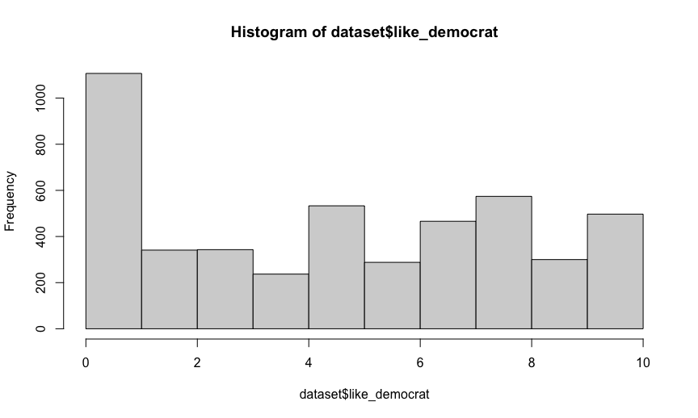

The bars show the shape that the mean and median describe. The first bar
counts the 0s and the 1s together. `breaks = seq(-0.5, 10.5, by = 1)`
gives one bar per value.

## Describe a variable (Lab 2) – as a figure

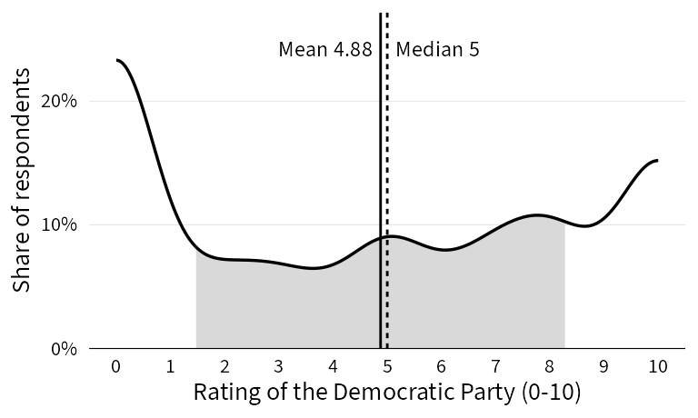

- **Curve**: how common each rating is (smoothed).
- **Mean** and **median** almost coincide: the distribution is roughly
  symmetric.
- **Shaded**: mean ± 1 standard deviation, from 1.5 to 8.3. It holds 59%
  of respondents: a large spread.

## Crosstab (Lab 2)

``` r
table(dataset$voted_2024, dataset$gender)
```

       
           1    2    3    4
      0  346  439    9    4
      1 1731 1976   33   12

Men and women voted at about the same rate: 83.3% of men and 81.8% of
women. Gender makes little difference to voting in this sample.

In the output: rows = voted (0 no, 1 yes), columns = gender (1 man, 2
woman, 3 nonbinary, 4 something else). These are counts:
`prop.table(table(...), margin = 2)` gives the share of each column.

## Group means (Lab 2)

``` r
aggregate(like_democrat ~ voted_2024, data = dataset, FUN = mean)
```

      voted_2024 like_democrat
    1          0      4.373077
    2          1      4.949704

Voters rate the Democratic Party higher than non-voters: 4.95 against
4.37 out of 10. The difference in the means suggests an association
between voting and the rating of the Democratic Party in this sample.

In the output: one row per group, `0` = did not vote, `1` = voted.
Whether the difference holds in the population is what the t-test checks
(Lab 3).

## Correlation (Lab 2)

``` r
cor(dataset$like_democrat, dataset$age, use = "complete.obs")
```

    [1] 0.02571812

There is a positive but negligible association between age and the
rating of the Democratic Party (r = 0.03): age makes almost no
difference to it.

Strength (Lecture 4): \|r\| below 0.10 negligible, from 0.10 weak, 0.30
moderate, 0.50 strong, 0.75 very strong. `use = "complete.obs"` leaves
out respondents with a missing value.

## Scatter plot (Lab 2)

``` r
plot(dataset$age, dataset$like_democrat)
```

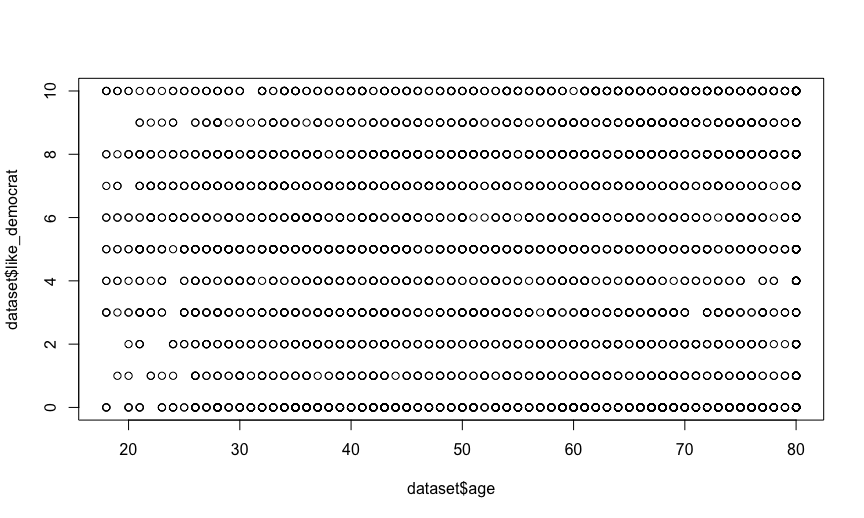

Each dot is a respondent. The ratings are whole numbers, so the dots
fall in rows and hide each other. No slope is visible: the same as r =
0.03.

## Lab 3

t-test and chi-square test · ANES 2024

## t-test (Lab 3)

``` r
t.test(dataset$swd ~ dataset$voted_2024)
```

        Welch Two Sample t-test

    data:  dataset$swd by dataset$voted_2024
    t = 8.2327, df = 1056.3, p-value = 5.355e-16
    alternative hypothesis: true difference in means between group 0 and group 1 is not equal to 0
    95 percent confidence interval:
     0.3044511 0.4949929
    sample estimates:
    mean in group 0 mean in group 1 
           2.973077        2.573355 

Voters are more satisfied with democracy than non-voters: their mean is
2.57 against 2.97 (lower = more satisfied), a difference of 0.40. The
difference is statistically significant at the 0.01 level: we reject the
null hypothesis that the means are equal.

In the output: `mean in group 0` = non-voters, `group 1` = voters.
`p-value` = 5.4^{-16}. The 95% confidence interval of the difference
does not include 0.

## Boxplot (Lab 3)

``` r
boxplot(dataset$swd ~ dataset$voted_2024)
```

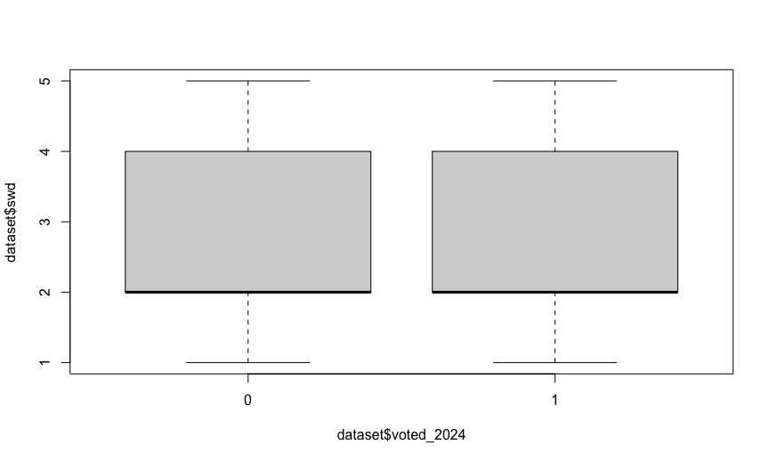

The thick line is the median, the box holds the middle half of the
respondents. `swd` has only four values (1, 2, 4, 5), so both boxes look
alike: the medians are both 2. The means (t-test) show the difference
better, as on the next slide.

## t-test (Lab 3) – as a figure

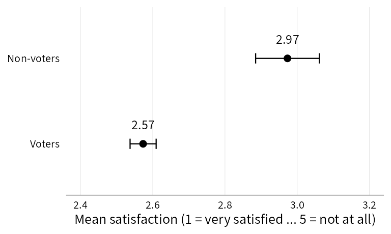

- Dot: the mean of each group. Line: its 95% confidence interval.
- The intervals don’t overlap: the difference is statistically
  significant.
- Lower means **more** satisfied: voters are more satisfied.

## Chi-square test (Lab 3)

``` r
table(dataset$swd_binary, dataset$voted_2024)
```

       
           0    1
      0  365 1147
      1  415 2561

``` r
chisq.test(dataset$swd_binary, dataset$voted_2024)
```

        Pearson's Chi-squared test with Yates' continuity correction

    data:  dataset$swd_binary and dataset$voted_2024
    X-squared = 71.87, df = 1, p-value < 2.2e-16

Voters are more often satisfied with democracy: 69% of voters against
53% of non-voters. The association is statistically significant at the
0.01 level: we reject the null hypothesis of no association between
voting and satisfaction.

In the output: rows = satisfied (1) or not (0), columns = voted (1) or
not (0). The test gives significance only. The direction comes from the
percentages, `prop.table(table(...), margin = 2)`. X-squared = 71.9.

## Chi-square test (Lab 3) – as a figure

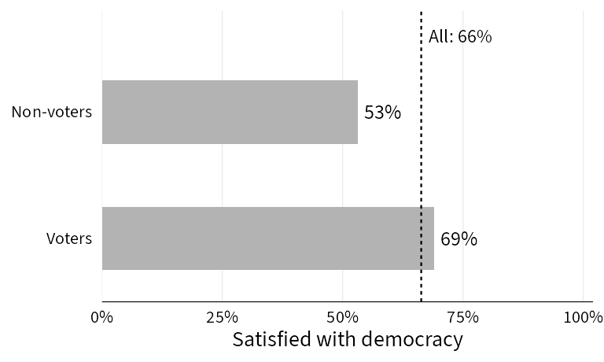

- Bars: the share satisfied in each group.
- Dashed line: what both groups would show with **no association** (the
  null hypothesis).
- Chi-square measures how far the groups are from that line. The bars
  give the direction.

## Lab 4

Linear regression, country fixed effects and diagnostics · ESS round 11

## OLS regression (Lab 4)

``` r
model1 <- lm(lrscale_clean ~ age + factor(gndr) + edu, data = dataset)
summary(model1)
```

                   Estimate Std. Error t value Pr(>|t|)    
    (Intercept)    5.517395   0.062060   88.90  < 2e-16 ***
    age            0.002967   0.000674    4.40  1.1e-05 ***
    factor(gndr)2 -0.302186   0.024287  -12.44  < 2e-16 ***
    edu           -0.030211   0.003079   -9.81  < 2e-16 ***

- **Education:** the more educated, the more to the left. One more year
  of education lowers left-right self-placement by 0.030 points, net of
  age and gender (statistically significant at the 0.01 level).
- **Gender:** women place themselves 0.30 points further left than men
  (statistically significant at the 0.01 level).
- **Age:** older people place themselves slightly further right, 0.003
  points per year (statistically significant at the 0.01 level).

In the output: `Estimate` gives the direction (sign) and the size,
`Pr(>|t|)` the p-value. R² = 0.009: together the variables explain 0.9%
of the variance.

## OLS regression (Lab 4) – as a figure

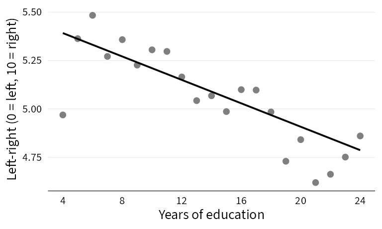

- Dots: the average left-right position for each year of education.
- Line: the regression’s prediction. Its slope is the education
  coefficient, -0.030 per year, net of age and gender.
- The line summarises the dots. It doesn’t pass through each one.
- [How this plot is built, layer by layer](animations/ggplot2-ols.html)
  (animated)

## Country fixed effects (Lab 4)

``` r
model2 <- lm(
  lrscale_clean ~ age + factor(gndr) + edu + factor(cntry),
  data = dataset
)
summary(model2)
```

                   Estimate Std. Error t value Pr(>|t|)    
    age            0.003318   0.000671    4.94  7.8e-07 ***
    factor(gndr)2 -0.325671   0.024067  -13.53  < 2e-16 ***
    edu           -0.027445   0.003167   -8.67  < 2e-16 ***

Net of the differences between countries, the effects barely change: one
more year of education lowers left-right self-placement by 0.027 points,
and women place themselves 0.33 points further left than men (both
statistically significant at the 0.01 level).

In the output: each respondent is now compared with others from the same
country. The country rows (`factor(cntry)BE`, …) compare each country
with Austria. R² rises from 0.009 to 0.033: the countries explain part
of the variance.

## Country fixed effects (Lab 4) – as a figure

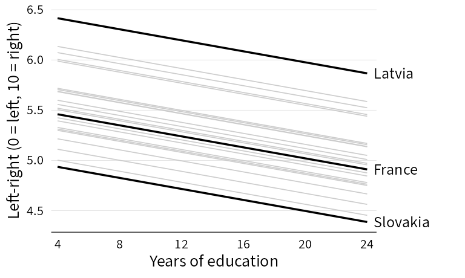

- Each line is one country.
- Different heights: each country has its own baseline. That baseline is
  the **fixed effect**.
- Parallel lines: one education effect, estimated **within** countries.

## One country only: France (Lab 4)

``` r
dataset_france <- subset(dataset, cntry == "FR")
model_france <- lm(
  lrscale_clean ~ age + factor(gndr) + edu,
  data = dataset_france
)
summary(model_france)
```

                  Estimate Std. Error t value Pr(>|t|)    
    (Intercept)    5.08818    0.32802   15.51  < 2e-16 ***
    age            0.01123    0.00318    3.53  0.00042 ***
    factor(gndr)2 -0.33142    0.11680   -2.84  0.00461 ** 
    edu           -0.03390    0.01777   -1.91  0.05655 .  

In France, older people place themselves further right (0.011 points per
year) and women 0.33 points further left than men (both statistically
significant at the 0.01 level). Education goes with a more left-wing
placement, 0.034 points per year, but only statistically significant at
the 0.10 level.

In the output: the model uses only the 1,570 French respondents, so the
standard errors are larger than with all countries.

## Residual plot (Lab 4)

``` r
plot(model2$fitted.values, model2$residuals)
abline(h = 0)
```

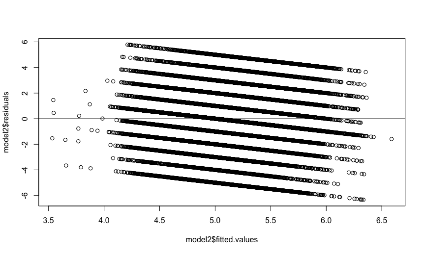

Each dot is a respondent: the model’s prediction (x) against its error
(y). If the vertical spread changes from left to right, the residuals
are heteroskedastic. The diagonal stripes come from `lrscale` taking
only whole values from 0 to 10. The Breusch-Pagan test on the next slide
checks it formally.

## Heteroskedasticity (Lab 4)

``` r
bptest(model2)
```

        studentized Breusch-Pagan test

    data:  model2
    BP = 1356, df = 25, p-value < 2.2e-16

We reject the null hypothesis of homoskedasticity (statistically
significant at the 0.01 level): the residuals are heteroskedastic. Their
variance is not the same across the fitted values, so the usual standard
errors are not reliable. The course’s fix: robust standard errors.

In the output: BP = 1356, df = 25 (the number of independent variables,
with the 22 country dummies). The null hypothesis is homoskedasticity,
so a small p-value means heteroskedasticity.

## Heteroskedasticity (Lab 4) – as a figure

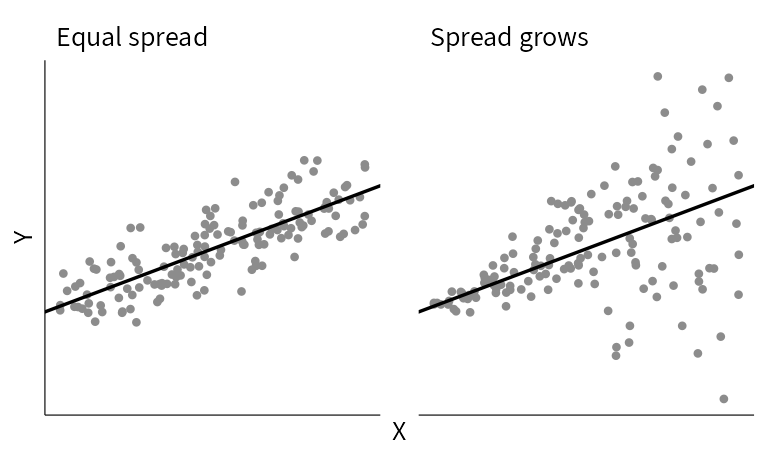

Simulated data, for illustration.

- Each dot is a person, the line is the regression’s prediction.
- Left: the line is equally good for everyone. Right: the further right,
  the more people are off the line.
- Why it’s bad: the line is still right, but the usual standard errors
  are wrong, so the p-values can’t be trusted.
- Our model is like the right one (Breusch-Pagan test). Fix: robust
  standard errors.

## Multicollinearity (Lab 4)

``` r
vif(model2)
```

                      GVIF Df GVIF^(1/(2*Df))
    age           1.071270  1        1.035022
    factor(gndr)  1.006579  1        1.003284
    edu           1.140503  1        1.067944
    factor(cntry) 1.106917 22        1.002311

All the VIFs are close to 1 (at most 1.14), well below 10:
multicollinearity is not a concern.

In the output: for `factor(cntry)`, which has many categories, read the
last column, `GVIF^(1/(2*Df))`.

## Multicollinearity (Lab 4) – as a figure

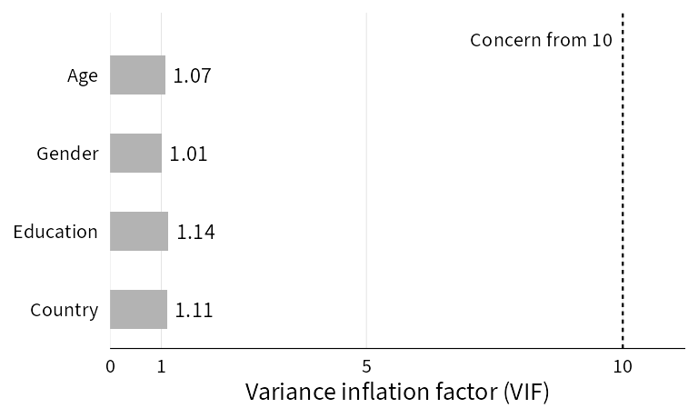

- VIF: how much a variable is explained by the other independent
  variables.
- Why it’s bad: if variables overlap, the model can’t tell their effects
  apart. The standard errors get large, so real effects can look not
  significant.
- 1 means no overlap. Below 10 is generally not a concern. All four are
  about 1: no multicollinearity.

## Lab 5

Logit, marginal effects, multinomial logit and interactions · ESS round
11.

## Recoding in base R (Lab 5, Step 2)

``` r
# 1 = far right (8-10), 0 = the rest (0-7)
dataset$far_right <- ifelse(
  dataset$lrscale_clean >= 8 & dataset$lrscale_clean <= 10,
  1,
  ifelse(
    dataset$lrscale_clean >= 0 & dataset$lrscale_clean <= 7,
    0,
    NA
  )
)
```

**Nested `ifelse()`:** if 8 to 10, then 1. Otherwise, if 0 to 7, then 0.
Otherwise `NA`. The second `ifelse()` is the “no” of the first.

The next slide does the same with dplyr.

## The same thing but tidier: Recoding with dplyr

``` r
library(dplyr)
dataset <- dataset |>
  mutate(
    # condition ~ new value, one line per group
    far_right = case_when(
      between(lrscale_clean, 8, 10) ~ 1,
      between(lrscale_clean, 0, 7) ~ 0,
      .default = NA
    )
  )
dataset |> count(far_right) # check
```

      far_right     n
    1         0 29289
    2         1  5151
    3        NA  5074

- One line per group, like the codebook. `between(x, 8, 10)` means 8 ≤ x
  ≤ 10.
- `.default = NA`: anything that matches no line (a missing code, `NA`)
  becomes `NA`.
- `count()` checks the result, like `table(x, useNA = "ifany")`.

## Logit output (Lab 5, Step 2)

``` r
summary(logit1) # far_right ~ age + factor(gndr) + edu + factor(cntry)
```

                     Estimate Std. Error z value Pr(>|z|)    
    (Intercept)     -2.898431   0.124556  -23.27  < 2e-16 ***
    age              0.009263   0.000884   10.48  < 2e-16 ***
    factor(gndr)2   -0.403955   0.031313  -12.90  < 2e-16 ***
    edu             -0.013909   0.004163   -3.34  0.00083 ***
    factor(cntry)BE  0.655731   0.125520    5.22  1.7e-07 ***
    factor(cntry)BG  1.340284   0.110387   12.14  < 2e-16 ***

- **Gender:** women are less likely than men to place themselves on the
  far right (statistically significant at the 0.01 level).
- **Age:** older people are more likely (statistically significant at
  the 0.01 level).
- **Education:** the more educated, the less likely (statistically
  significant at the 0.01 level).

In the output: in a logit, only the sign of `Estimate` is interpreted.
The size comes from the marginal effects. `factor(gndr)2` = women vs men
(the reference has no row), `factor(cntry)BE` = Belgium vs Austria.
Stars: R’s `***` 0.001, `**` 0.01, `*` 0.05 are not the course’s 0.01,
0.05, 0.10 (Lecture 8, slide 41): go by the p-value.

## One effect, three numbers (Lab 5)

The same model, the same effect of being a woman, on three scales:

**Log-odds** `summary(logit1)`

-0.40

Only the sign: women are less likely to be on the far right.

**Odds ratio** `exp(coef(logit1))`

0.67

Women’s odds are 33% lower.

**Marginal effect** `summary(margins(logit1))`

-0.050

× 100: women are 5.0 percentage points less likely.

In the exam: the direction and significance from `summary()`, the size
from the marginal effects.

## Log-odds and odds ratios (beyond the course)

``` r
exp(coef(logit1))[c("age", "factor(gndr)2", "edu")]
```

              age factor(gndr)2           edu 
        1.0093063     0.6676743     0.9861869 

- **`summary(logit1)` gives log-odds:** the change in log(p / (1 − p))
  when X goes up by one. That is hard to read, so the course reads only
  the sign (Lecture 10).
- **`exp()` turns them into odds ratios.** Above 1: higher odds. Below
  1: lower odds. Women: 0.67, so their odds of being on the far right
  are 33% lower than men’s.
- **Odds are not probabilities.** For the size, the course uses the
  marginal effects, in percentage points (the marginal effects slide).

## Logit output, the bottom (Lab 5, Step 2)

``` r
summary(logit1)
```

    (Dispersion parameter for binomial family taken to be 1)

        Null deviance: 28608  on 33944  degrees of freedom
    Residual deviance: 27292  on 33919  degrees of freedom
      (5569 observations deleted due to missingness)
    AIC: 27344

    Number of Fisher Scoring iterations: 5

- **Residual deviance**: how badly this model fits. Lower is better:
  compare models with it.
- **Null deviance**: the same, for a model without variables.
- **Degrees of freedom**: observations − coefficients (33,945 − 26).

- **Observations deleted**: rows with an `NA`. The model used 33,945
  (`nobs(logit1)`).
- **AIC**, Akaike information criterion
  ([explainer](https://en.wikipedia.org/wiki/Akaike_information_criterion)):
  lower is better, on the same data only.
- **Dispersion**, **Fisher Scoring**: ignore them.

## Comparing models (Lab 5, Step 2)

``` r
logit0 <- glm(
  far_right ~ age + factor(gndr) + edu, # logit1 without the countries
  data = dataset,
  family = binomial
)
anova(logit0, logit1, test = "Chisq")
```

    Analysis of Deviance Table

    Model 1: far_right ~ age + factor(gndr) + edu
    Model 2: far_right ~ age + factor(gndr) + edu + factor(cntry)
      Resid. Df Resid. Dev Df Deviance  Pr(>Chi)    
    1     33941      28320                          
    2     33919      27292 22   1027.5 < 2.2e-16 ***

The model with country fixed effects fits better: its residual deviance
is lower (27,292 against 28,320), and the drop is statistically
significant at the 0.01 level.

In the output: `Resid. Dev` = each model’s residual deviance (lower =
better fit), `Deviance` = the drop from model 1 to model 2, `Pr(>Chi)` =
the p-value of that drop. Compare only models on the same respondents:
check with `nobs()`.

## Marginal effects (Lab 5, Step 2)

``` r
summary(margins(logit1))
```

      factor     AME     SE        z      p   lower   upper
         age  0.0011 0.0001  10.4921 0.0000  0.0009  0.0013
     cntryBE  0.0479 0.0095   5.0667 0.0000  0.0294  0.0664
     cntryBG  0.1314 0.0105  12.5638 0.0000  0.1109  0.1519
         edu -0.0017 0.0005  -3.3421 0.0008 -0.0027 -0.0007
       gndr2 -0.0496 0.0038 -12.8889 0.0000 -0.0571 -0.0421

- **Gender:** women are 5.0 percentage points less likely than men to
  place themselves on the far right, net of age, education and country
  (statistically significant at the 0.01 level).
- **Age:** each year of age raises the probability by 0.11 percentage
  points (statistically significant at the 0.01 level).
- **Education:** each year of education lowers it by 0.17 percentage
  points (statistically significant at the 0.01 level).

In the output: `AME` × 100 = percentage points. `lower`, `upper` = its
95% confidence interval, `p` = the p-value.

## Logit (Lab 5) – as a figure

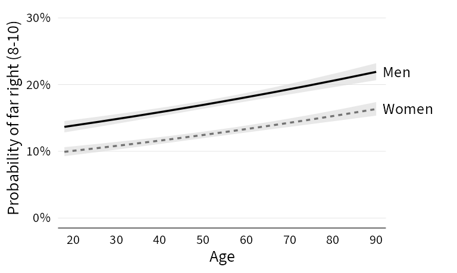

- Lines: the predicted probability of placing oneself on the far right,
  for an average education.
- The gap between the lines is the marginal effect of gender: about 5
  percentage points.
- The slope is the marginal effect of age: about 1.0 percentage points
  per 10 years.

## Recoding in base R (Lab 5, Step 3)

``` r
# start with NA, then fill in each group
dataset$left_right_3cat <- NA
dataset$left_right_3cat[
  dataset$lrscale_clean >= 0 & dataset$lrscale_clean <= 3
] <- 1
dataset$left_right_3cat[
  dataset$lrscale_clean >= 4 & dataset$lrscale_clean <= 6
] <- 2
dataset$left_right_3cat[
  dataset$lrscale_clean >= 7 & dataset$lrscale_clean <= 10
] <- 3
```

**`x[condition] <- value`:** changes only the rows where the condition
is `TRUE`, so each line fills in one group. Rows that match no line keep
the `NA`.

The next slide does the same with dplyr.

## Recoding with dplyr (Lab 5, Step 3)

``` r
dataset <- dataset |>
  mutate(
    # three groups with readable labels
    left_right_3cat = case_when(
      between(lrscale_clean, 0, 3) ~ "Left",
      between(lrscale_clean, 4, 6) ~ "Centre",
      between(lrscale_clean, 7, 10) ~ "Right",
      .default = NA
    ),
    # the first level is the reference category
    left_right_3cat = factor(
      left_right_3cat,
      levels = c("Left", "Centre", "Right")
    )
  )
```

- Labels instead of 1, 2, 3: the output says “Centre” and “Right”, not
  “2” and “3”.
- `levels = …`: Left first, so Left is the reference. Without it, text
  is sorted alphabetically and Centre would be the reference.

## Check the recode (Lab 5, Step 3)

``` r
dataset |>
  count(left_right_3cat)
```

      left_right_3cat     n
    1            Left  7620
    2          Centre 17958
    3           Right  8862
    4            <NA>  5074

``` r
dataset |>
  count(lrscale_clean, left_right_3cat)
```

       lrscale_clean left_right_3cat     n
    1              0            Left  1318
    2              1            Left   775
    3              2            Left  2005
    4              3            Left  3522
    5              4          Centre  3339
    6              5          Centre 11259
    7              6          Centre  3360
    8              7           Right  3711
    9              8           Right  2852
    10             9           Right   928
    11            10           Right  1371
    12            NA            <NA>  5074

Left: how many in each group. Right: which original value went into
which group, so a wrong boundary shows at once. `NA` = the missing
values.

## Reference categories: see and change

The first level of a factor is the reference. It gets no row, and every
other level is compared with it.

``` r
levels(factor(dataset$gndr)) # men (1) are the reference
```

    [1] "1" "2"

``` r
levels(dataset$left_right_3cat) # Left is the reference
```

    [1] "Left"   "Centre" "Right" 

``` r
# women as the reference
dataset$gndr_f <- relevel(factor(dataset$gndr), ref = "2")
# the whole order, Centre first
dataset$left_right_3cat <- factor(
  dataset$left_right_3cat,
  levels = c("Centre", "Left", "Right")
)
```

## Good to know: Which reference category to choose?

- **The group you want to compare with**, so the coefficients answer
  your question. To ask how women differ, men are the reference.
- **A clear group**, not “other” or “something else”.
- **Not a small group**: every coefficient is a comparison with it, so a
  small reference makes them all uncertain.
- Changing the reference changes the coefficients, not the model: the
  predictions and the fit stay the same.

[Hardy, *Regression with Dummy Variables*
(1993)](https://doi.org/10.4135/9781412985628)

## Multinomial logit (Lab 5, Step 3)

``` r
mlogit1 <- multinom(
  left_right_3cat ~ age + factor(gndr) + edu + factor(cntry),
  data = dataset
)
```

    # weights:  81 (52 variable)
    initial  value 37292.394139 
    iter  10 value 34263.554893
    iter  20 value 34039.290995
    iter  30 value 33796.606462
    iter  40 value 33728.345070
    iter  50 value 33717.970193
    iter  60 value 33717.553823
    final  value 33717.517516 
    converged

- **`iter … value`**: R searches step by step for the best coefficients.
  Ignore it.
- **`converged`**: the search is finished. “stopped after 100
  iterations” would mean it is not.
- `multinom(…, trace = FALSE)` hides these lines.

## Multinomial logit output (Lab 5, Step 3)

``` r
summary(mlogit1)
```

    Coefficients:
           (Intercept)    age factor(gndr)2    edu
    Centre       2.101 -0.003        -0.049 -0.043
    Right        0.083  0.004        -0.415 -0.035
    Std. Errors:
           (Intercept)   age factor(gndr)2   edu
    Centre       0.093 0.001         0.028 0.004
    Right        0.116 0.001         0.032 0.004

- **Rows**: each category compared with Left, the reference.
- **Columns**: the variables.
- **No p-values**: see the next slide.

## Multinomial logit: p-values (Lab 5, Step 3)

`summary(mlogit1)` gives no p-values. Divide each coefficient by its
standard error to get z:

``` r
z <- coef(mlogit1) / summary(mlogit1)$standard.errors
p <- 2 * pnorm(-abs(z)) # two-sided p-values
round(p[, 1:4], 3)
```

           (Intercept) age factor(gndr)2 edu
    Centre       0.000   0         0.083   0
    Right        0.477   0         0.000   0

- Compared with the left, women are less likely than men to place
  themselves on the right (statistically significant at the 0.01 level).
- They are also slightly less likely to be in the centre, but this is
  statistically significant at the 0.10 level only.

In the output: rows = Centre vs Left and Right vs Left, columns = the
variables. As in a logit, only the signs are interpreted.

## Multinomial logit (Lab 5) – as a figure

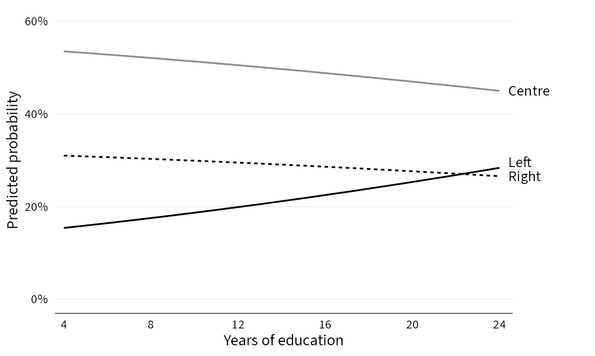

## Interaction: gender × education (Lab 5, Step 4)

``` r
model1 <- lm(
  lrscale_clean ~ age + factor(gndr) * edu + factor(cntry),
  data = dataset
)
```

                      Estimate Std. Error t value Pr(>|t|)    
    factor(gndr)2     -0.18176    0.08359   -2.17    0.030 *  
    edu               -0.02166    0.00451   -4.80  1.6e-06 ***
    factor(gndr)2:edu -0.01075    0.00598   -1.80    0.072 .  

The more educated place themselves further left, and a little more so
among women: -0.022 points per year of education for men, -0.032 for
women. The interaction is statistically significant at the 0.10 level
only: weak evidence that gender moderates the effect of education.

In the output: `edu` = the slope for men (the reference).
`factor(gndr)2:edu` = how much the slope differs for women. It is the
last row of `summary()`, after the countries. `factor(gndr)2` = the gap
at 0 years of education, not meaningful on its own.

## Interaction (Lab 5) – as a figure

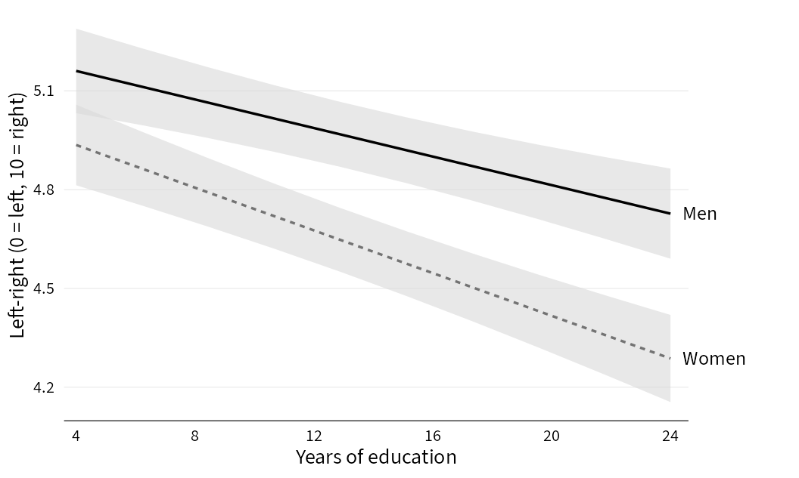

## Interaction: education × income feeling (Lab 5, Step 5)

``` r
dataset$income_feeling <- ifelse(
  dataset$hincfel >= 1 & dataset$hincfel <= 4,
  dataset$hincfel,
  NA
)
model2 <- lm(
  lrscale_clean ~ age +
    factor(gndr) +
    edu * income_feeling +
    factor(cntry),
  data = dataset
)
```

                       Estimate Std. Error t value Pr(>|t|)    
    edu                -0.04842    0.00753   -6.43  1.3e-10 ***
    income_feeling     -0.25080    0.04928   -5.09  3.6e-07 ***
    edu:income_feeling  0.00779    0.00360    2.16    0.031 *  

`income_feeling` runs backwards: 1 = living comfortably … 4 = very
difficult.

## Reading education × income feeling (Lab 5, Step 5)

The slope at each level is `edu` + interaction × level:

``` r
slopes <- cf2["edu"] + cf2["edu:income_feeling"] * 1:4
round(slopes, 3) # comfortable, coping, difficult, very difficult
```

    [1] -0.041 -0.033 -0.025 -0.017

More education goes with a more left-wing placement, but less so for
people who find it hard to live on their income: -0.041 per year for
those living comfortably, -0.017 for those finding it very difficult.
The interaction is statistically significant at the 0.05 level.

In the output: `edu:income_feeling` = how much the education slope
changes with each step on the income scale. `edu` alone = the slope at
`income_feeling` = 0, which doesn’t exist (the scale is 1 to 4).

## easystats

The same analyses in fewer steps, with the easystats packages.

## easystats: a clean coefficient table

``` r
library(parameters)
model_parameters(m)
```

    Parameter   | Coefficient |       SE |         95% CI | t(33941) |      p
    -------------------------------------------------------------------------
    (Intercept) |        5.52 |     0.06 | [ 5.40,  5.64] |    88.90 | < .001
    age         |    2.97e-03 | 6.74e-04 | [ 0.00,  0.00] |     4.40 | < .001
    gndr [2]    |       -0.30 |     0.02 | [-0.35, -0.25] |   -12.44 | < .001
    edu         |       -0.03 | 3.08e-03 | [-0.04, -0.02] |    -9.81 | < .001

    Uncertainty intervals (equal-tailed) and p-values (two-tailed) computed
      using a Wald t-distribution approximation.

Coefficients, 95% confidence intervals and p-values in one table. All
packages are allowed in the lab exam (the TA, 19 Nov). One install for
all of easystats: `install.packages("easystats")`
([easystats.github.io](https://easystats.github.io/easystats/)).

## easystats: tests in words

``` r
library(report)
report(t.test(swd ~ voted_2024, data = anes))
```

    Effect sizes were labelled following Cohen's (1988) recommendations.

    The Welch Two Sample t-test testing the difference of swd by voted_2024 (mean
    in group 0 = 2.97, mean in group 1 = 2.57) suggests that the effect is
    positive, statistically significant, and medium (difference = 0.40, 95% CI
    [0.30, 0.49], t(1056.34) = 8.23, p < .001; Cohen's d = 0.51, 95% CI [0.38,
    0.63])

A useful check of your own sentence. It labels effect sizes with Cohen’s
d (“medium”), which the course doesn’t use: report the significance
level and the direction in the course’s terms.

## easystats: a correlation in words

``` r
report(cor.test(anes$like_democrat, anes$age))
```

    Effect sizes were labelled following Funder's (2019) recommendations.

    The Pearson's product-moment correlation between anes$like_democrat and
    anes$age is positive, statistically not significant, and tiny (r = 0.03, 95% CI
    [-3.54e-03, 0.05], t(4487) = 1.72, p = 0.085)

report() labels strength after Funder (2019) and tests only at the 0.05
level. The course uses its own conventions, so in the exam write it the
course’s way:

- Strength: **negligible** (bands 0.10 / 0.30 / 0.50 / 0.75, Lecture 4
  *Measures of association*, slide 21)
- Significance: statistically significant at the 0.10 level, p = 0.085
  (levels 0.10 / 0.05 / 0.01, lecture *Hypothesis testing*, slide 6)

## easystats: diagnostics in words (Lab 4)

``` r
library(performance)
check_heteroscedasticity(m_fe)
```

    Warning: Heteroscedasticity (non-constant error variance) detected (p < .001).

``` r
check_collinearity(m_fe)
```

    # Check for Multicollinearity

    Low Correlation

              Term  VIF   VIF 95% CI adj. VIF Tolerance Tolerance 95% CI
               age 1.07 [1.06, 1.08]     1.04      0.93     [0.93, 0.94]
      factor(gndr) 1.01 [1.00, 1.01]     1.00      0.99     [0.99, 1.00]
               edu 1.14 [1.13, 1.15]     1.07      0.88     [0.87, 0.88]
     factor(cntry) 1.11 [1.10, 1.11]     1.00      0.90     [0.90, 0.91]

The same results as `bptest()` and `vif()`, with the conclusion spelled
out: heteroskedasticity, and no multicollinearity.

## easystats: compare models (Lab 4)

``` r
performance::compare_performance(m, m_fe, rank = TRUE)
```

    # Comparison of Model Performance Indices

    Metric            |    m_fe |         m
    ---------------------------------------
    Model             |      lm |        lm
    R2                |   0.033 |     0.009
    R2 (adj.)         |   0.032 |     0.009
    RMSE              |   2.206 |     2.233
    Sigma             |   2.206 |     2.233
    AIC weights       |    1.00 | 1.50e-173
    AICc weights      |    1.00 | 1.53e-173
    BIC weights       |    1.00 | 2.88e-133
    Performance-Score | 100.00% |     0.00%

- **`rank = TRUE`**: the better model comes first.
- **Performance-Score**: the share of metrics on which the model is the
  better one. `m_fe` wins on all: 100%.
- **AIC weights**: the weight of evidence that the model is the best of
  those compared. Here 1.00 for `m_fe`.
- A quick ranking, not a test.

## easystats: the comparison in words (Lab 4)

``` r
report::report(performance::compare_performance(m, m_fe))
```

    We compared two models; lm (R2 = 8.61e-03, adj. R2 = 8.52e-03, AIC = 1.51e+05,
    BIC = 1.51e+05, RMSE = 2.23, Sigma = 2.23) and lm (R2 = 0.03, adj. R2 = 0.03,
    AIC = 1.50e+05, BIC = 1.50e+05, RMSE = 2.21, Sigma = 2.21).

It calls both models “lm”: the first is `m`, the second `m_fe`. In the
course’s words: the country fixed effects raise R² from 0.009 to 0.033.

## easystats: test models (Lab 5)

``` r
performance::test_performance(logit0, logit1)
```

    Name   | Model |     BF | Omega2 | p (Omega2) |      LR | p (LR)
    ----------------------------------------------------------------
    logit0 |   glm |        |        |            |         |       
    logit1 |   glm | > 1000 |   0.03 |     < .001 | 1027.51 | < .001
    Models were detected as nested (in terms of fixed parameters) and are compared in sequential order.

- **`LR`**, **`p (LR)`**: the same test as
  `anova(logit0, logit1, test = "Chisq")`.
- **`BF`**, **`Omega2`**: other tests, not in the course.

## easystats: summary

``` r
summary(report(m))
```

    We fitted a linear model to predict lrscale_clean with age, gndr and edu. The
    model's explanatory power is very weak (R2 = 8.61e-03, adj. R2 = 8.52e-03). The
    model's intercept is at 5.52 (95% CI [5.40, 5.64]). Within this model:

      - The effect of age is statistically significant and positive (beta = 2.97e-03,
    95% CI [1.65e-03, 4.29e-03], t(33941) = 4.40, p < .001, Std. beta = 0.02)
      - The effect of gndr [2] is statistically significant and negative (beta =
    -0.03, 95% CI [-0.04, -0.02], t(33941) = -9.81, p < .001, Std. beta = -0.13)
      - The effect of edu is statistically significant and negative (beta = -0.30,
    95% CI [-0.35, -0.25], t(33941) = -12.44, p < .001, Std. beta = -0.05)

Compare with `summary()`: women’s coefficient is -0.30 and education’s
-0.03. `report()` swaps the two. Tools make mistakes too: check every
number against `summary()` before you use it.

## 4 · Fixing Errors

## Common error messages

| Message | Usually means |
|----|----|
| `object 'x' not found` | a typo, wrong capitals, or the line that creates `x` hasn’t run |
| `could not find function` | the package isn’t loaded |
| `unexpected symbol` / `')'` | a missing comma, quote or bracket |
| result is `NA` | missing values: add `na.rm = TRUE` |
| `grouping factor must have exactly 2 levels` | the `t.test` group doesn’t have exactly two values: check it with `table()` |
| `replacement has 0 rows` | the column doesn’t exist, often after a wrong import |

Start with the last line of the message, then try `?function`. If you’re
still stuck, give the AI your code together with the error.

## Check every step

``` r
table(dataset$lrscale_clean, useNA = "ifany")
```

        0     1     2     3     4     5     6     7     8     9    10  <NA> 
     1318   775  2005  3522  3339 11259  3360  3711  2852   928  1371  5074 

- Only valid values and `NA` left: the recode worked.
- `table(old, new, useNA = "ifany")` shows where each old code ended up.
- `summary(x)`: a maximum of 99 or 999 is a missing-value code.
- `nobs(model)`: the number of rows the model used.

## 5 · Using AI

## Anatomy of a prompt

| Element | What it is | For an R question |
|----|----|----|
| Instruction | “a specific task or instruction you want the model to perform” | fix this error, explain this output |
| Context | “external information or additional context that can steer the model to better responses” | base R as in the labs, the variable codes from `table()` |
| Input data | “the input or question that we are interested to find a response for” | your code and the full error message |
| Output indicator | “the type or format of the output” | one sentence per line of code |

Source: DAIR.AI, [*Prompt Engineering Guide*, “Elements of a
Prompt”](https://www.promptingguide.ai/introduction/elements)

## Asking AI for help

The model makers’ own guides go further:

- Anthropic: [Prompt engineering
  overview](https://platform.claude.com/docs/en/build-with-claude/prompt-engineering/overview)
- OpenAI: [Prompt
  engineering](https://developers.openai.com/api/docs/guides/prompt-engineering)
- Google: [Prompt design
  strategies](https://aistudio.google.com/docs/prompting-strategies)

What you do with the answer:

- run it line by line and check the result with `table()` and
  `summary()`
- write the interpretations yourself, so your answers don’t read like
  everyone else’s

## Beyond the Chat

|  | What | Works with |
|----|----|----|
| 1 | Chat in the browser, copy and paste | any account |
| 2 | A desktop app opened on `labexam/`, which reads your files and runs R | ChatGPT app (Codex), Claude app, Code tab (paid plan) |
| 3 | Inside **RStudio**: Posit Assistant, Agent engines, Codex Agent | ChatGPT sign-in, plus one terminal step |
| 4 | Posit Assistant with Posit AI Pass | \$5 for the first month, then \$20 a month |

The [AI setup page](ai-setup.html) has the steps. Give an agent only the
project folder, and read every change it makes.

## 6 · Why R Is Cool

## Publication-ready figures (with the [ggplot2](https://ggplot2.tidyverse.org) package)

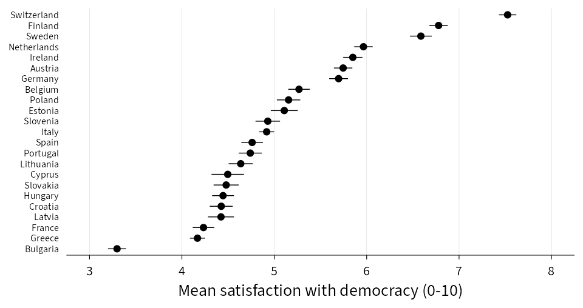

Figure: Mean satisfaction with democracy by country, with 95% confidence
intervals. Data: European Social Survey, round 11 (unweighted).

## Pretty regression tables

[TABLE]

Made with the [modelsummary](https://modelsummary.com) package, which
also writes Word and LaTeX tables.

## These slides are made with R

This whole deck is one [Quarto](https://quarto.org) file: Markdown text
with R chunks that run every time on render. Every number, figure and
table comes straight from the data.

**Source Code**

```` markdown
```{r}
avg <- mean(dataset$swd, na.rm = TRUE)
avg
```

The mean is `r round(avg, 1)`.
````

**Slides**

``` r
avg <- mean(dataset$swd, na.rm = TRUE)
avg
```

    [1] 5.073292

The mean is 5.1.

Try it in RStudio: *File › New File › Quarto Presentation*. The same
works for papers (Word, PDF) and websites. [Source of these
slides](source.qmd)

## 7 · Practice

## Tuesday

Expect the steps from the labs, applied to variables you haven’t seen:
inspect, clean, check, describe, test, model, and interpret each result
in your own words.

[Mock exam](mock-exam.html) · [Cheat sheet](cheatsheet.html)

To keep learning (all free online): [Hands-On Programming with
R](https://rstudio-education.github.io/hopr/) for R itself, then [R for
Data Science](https://r4ds.hadley.nz) for data analysis, and the [Posit
cheat sheets](https://posit.co/resources/cheatsheets/).

## Appendix: Every Lab Function

## Start and import

| Function | What it does | Example from the labs | Watch out |
|----|----|----|----|
| `install.packages()` | downloads a package, once per computer | `install.packages("car")` | in the console, not in the exam script |
| `library()` | loads a package for this session | `library(car)` | every session (the stats package is always loaded) |
| `getwd()` | shows the working directory | `getwd()` | with a project it’s the project folder |
| `list.files()` | lists the files in a folder | `list.files("data")` | the exact file name to use |
| `read.csv()` | imports a comma-separated file | `read.csv("data/ess.csv")` | path relative to the project |
| `read.csv2()` | imports a semicolon-separated file | `read.csv2("students.csv")` | use one of the two, not both |
| `names()` | the variable names | `names(dataset)` |  |
| `dim()`, `nrow()` | rows × columns | `dim(dataset)` | rows = respondents |
| `head()` | the first rows | `head(dataset)` |  |
| `str()` | the type of each variable | `str(dataset)` | `chr` = text, `int`/`num` = numbers |

## Inspect and clean

| Function | What it does | Example from the labs | Watch out |
|----|----|----|----|
| `table()` | counts each value | `table(dataset$V242065)` | add `useNA = "ifany"` to see `NA` |
| `summary()` | min, quartiles, mean, max | `summary(dataset$agea)` | a max of 999 is a code |
| `unique()`, `sort()` | the distinct values | `sort(unique(dataset$lrscale))` |  |
| `ifelse()` | if-then for every row | `ifelse(x %in% c(77, 88, 99), NA, x)` | `ifelse(condition, yes, no)` |
| `%in%` | “is one of” | `x %in% c(1, 2, 3)` |  |
| `==`, `!=`, `>=`, `&`, \| | compare, AND, OR | `x >= 0 & x <= 10` | `==` compares, `=` sets an argument |
| `NA` | missing value | `ifelse(..., x, NA)` | no quotes: `"NA"` is text |
| `is.na()` | TRUE where missing | `sum(is.na(dataset$age))` | `x == NA` doesn’t work |
| `x[condition] <- value` | change only the matching rows | `d$cat[d$x <= 3] <- 1` | Lab 5’s 3-category recode |
| `factor()` | treat numbers as categories | `factor(gndr)` | first level = reference |
| `subset()` | keep the matching rows | `subset(dataset, cntry == "FR")` | text needs quotes |
| `mutate()` + `case_when()` | dplyr recode | Lab 3 solution | needs `library(dplyr)` |

## Describe and compare

| Function | What it does | Example from the labs | Watch out |
|----|----|----|----|
| `mean()`, `median()`, `sd()` | centre, spread | `mean(x, na.rm = TRUE)` | without `na.rm` → `NA` |
| `prop.table()` | turns counts into proportions | `prop.table(table(x, y), 1) * 100` | `1` = row %, `2` = column % |
| `round()` | rounds | `round(x, 1)` | halves round to even |
| `hist()` | histogram | `hist(dataset$like_democrat)` | for a 0 to 10 scale: `breaks = seq(-0.5, 10.5, 1)` |
| `barplot()` | bar chart of counts | `barplot(table(x))` |  |
| `boxplot()` | distribution by group | `boxplot(swd ~ voted_2024, data = d)` |  |
| `plot()` | scatter plot | `plot(d$age, d$like_democrat)` | x first, then y |
| `aggregate()` | statistic by group | `aggregate(y ~ group, data = d, FUN = mean)` | drops `NA` itself |
| `cor()` | correlation r | `cor(x, y, use = "complete.obs")` | no p-value: `cor.test()` |
| `t.test()` | difference of two means | `t.test(y ~ group, data = d)` | the group needs exactly 2 values |
| `chisq.test()` | association of two categorical variables | `chisq.test(table(x, y))` | no direction: look at the % |

## Models

| Function | What it does | Example from the labs | Watch out |
|----|----|----|----|
| `lm()` | linear regression (OLS) | `lm(y ~ age + factor(gndr) + edu, data = d)` | `factor()` for categories |
| `summary(model)` | coefficients, p-values, R² | `summary(model1)` | note how many rows were deleted |
| `confint()` | 95% confidence intervals | `confint(model1)` |  |
| `nobs()` | rows the model used | `nobs(model1)` |  |
| `coef()` | the coefficients as numbers | `coef(m)["edu"]` | for interaction arithmetic |
| `glm(…, family = binomial)` | logistic regression | `glm(far_right ~ …, family = binomial)` | only the sign of the coefficients |
| `margins()` | average marginal effects | `summary(margins(logit1))` | × 100 = percentage points |
| `multinom()` | multinomial logit | `multinom(y3 ~ …, data = d)` | reference = first level, `library(nnet)` |
| `x1 * x2` | interaction | `factor(gndr) * eduyrs` | slope for group 2 = `b_x` + `b_int` |
| `bptest()` | Breusch-Pagan test | `bptest(model2)` | H0: homoskedasticity, `library(lmtest)` |
| `vif()` | multicollinearity | `vif(model2)` | below 10: not a concern, `library(car)` |
| `plot(fitted, resid)` + `abline(h = 0)` | residual plot | `plot(m$fitted.values, m$residuals)` | look for a spread that changes |
