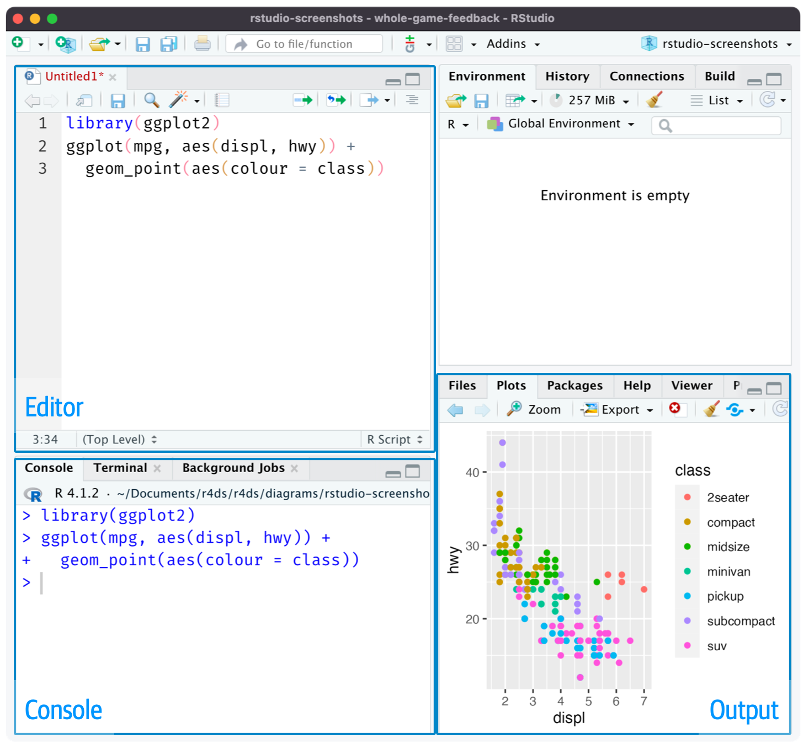

```{r}
#| include: false
dataset <- read.csv("data/ess_lab.csv")
dataset$lrscale_clean <- ifelse(
  dataset$lrscale %in% c(77, 88, 99),
  NA,
  dataset$lrscale
)
dataset$age <- ifelse(dataset$agea == 999, NA, dataset$agea)
dataset$edu <- ifelse(
  dataset$eduyrs %in% c(77, 88, 99),
  NA,
  dataset$eduyrs
)
```

## Today {.center}

::: {.columns}
::: {.column width="50%"}
**By the end you should have**

- an **RStudio** project you can reuse<br> on Tuesday
- a feel for how R reads a line of code
- a routine for fixing errors, with or<br>without AI
:::
::: {.column width="50%"}
**The idea of this session**

- code along and interrupt with any questions
- everything builds on TAs' labs and the lecture
- I am just a nerd who likes to share R <3
- slides are recycled from my time as a TA
:::
:::

## 1 · Setting Up a Project {.center background-color="#1f3a5f"}

##  and RStudio

::: {.columns}
::: {.column width="50%"}
{fig-alt="RStudio with the Editor, Console and Output panes highlighted."}

[Figure: Wickham et al., [*R for Data Science* (2e)](https://r4ds.hadley.nz/workflow-scripts.html), CC BY-NC-ND 3.0]{.figure-credit}
:::
::: {.column width="50%"}
**R** does the statistics. **RStudio** is where you write it.

- **Editor:** your script, the file you hand in
- **Console:** runs R.<br>`>` ready, `+` unfinished line
- **Terminal:** not R, only for setup
- **Environment:** data objects & variables in memory
- **Output:** plots, help, files
:::
:::

## Best Practice: One folder per project

::: {.columns}
::: {.column width="45%"}
A good folder structure (example):
```
labexam/
├── labexam.Rproj    ← double-click this
├── data/
│   ├── anes_….csv
│   └── ess.csv
├── output/
└── Lastname_Firstname.R
```
:::
::: {.column width="55%"}
- In **RStudio**, create one with:<br> *File > New Project > New Directory*.
- Opening `labexam.Rproj` automatically makes this folder the working directory.
- `read.csv("data/ess.csv")` then works on any computer, without `setwd()`.
- [TIP] Before you hand in:<br> *Session > Restart R*, then run the whole script again to make sure it works.
:::
:::

## Best Practice: Start every session from a clean slate

By default, **RStudio** saves everything in memory to `.RData` when you quit and loads it again next time. Yesterday's objects come back, and a script can seem to work only because of them.

::: {.columns}
::: {.column width="55%"}
*Tools > Global Options > General*:

- untick **Restore .RData into workspace at startup**
- set **Save workspace to .RData on exit** to **Never**
:::
::: {.column width="45%"}
Or run this once in the Console:

```{r}
#| eval: false
install.packages("usethis")
usethis::use_blank_slate()
```
:::
:::

Your script is what counts. To test it: *Session > Restart R* (Cmd+Shift+0 on a Mac, Ctrl+Shift+F10 on Windows), then run everything from the top.

## The top of your script might look something like this

```{r}
#| eval: false
# Lab exam · Lastname Firstname

library(lmtest)
library(car)
library(margins)
library(nnet)

dataset <- read.csv("data/ess.csv")
dim(dataset)
```

Install the packages once, in the Console (not in the script):

```{r}
#| eval: false
install.packages(c("dplyr", "lmtest", "car", "margins", "nnet"))
```

## 2 · How R Reads Code {.center background-color="#1f3a5f"}

## Three patterns you see in every lab script

| Pattern | Read it as | Example |
|---|---|---|
| `name <- value` | "name gets value" | `x <- c(3, 7, 10)` |
| `function(arguments)` | "do this, with these settings" | `mean(x, na.rm = TRUE)` |
| `dataset$var` | "the column var of dataset" | `dataset$agea` |

```{r}
x <- c(3, 7, 10)
mean(x)
dataset$agea[1:6] # [ ] picks elements: here the first six
```

## A condition gives TRUE or FALSE for every row

```{r}
# one answer per row
head(dataset$agea >= 18)

# TRUE counts as 1: how many missing codes?
sum(dataset$lrscale %in% c(77, 88, 99))

# the share of women
mean(dataset$gndr == 2)
```

## `ifelse()` is Excel's `IF()` for every row

```{r}
dataset$lrscale_clean <- ifelse(
  # condition, checked for every row
  test = dataset$lrscale %in% c(77, 88, 99),
  # value where the condition is TRUE
  yes = NA,
  # value where it is FALSE
  no = dataset$lrscale
)

table(dataset$lrscale_clean, useNA = "ifany")
```

> `useNA` controls if the table includes counts of `NA` values: the allowed values correspond to never (`"no"`), only if the count is positive (`"ifany"`) and even for zero counts (`"always"`). (`?table`)
>
> The default is `"no"`, which would hide the `r format(sum(is.na(dataset$lrscale_clean)), big.mark = ",")` new `NA`s.

## One `NA` makes the result `NA`

```{r}
mean(c(4, 6, NA))
mean(c(4, 6, NA), na.rm = TRUE)
```

- `na.rm = TRUE` in `mean()`, `sd()` and `median()`
- `use = "complete.obs"` in `cor()`
- `lm()` and `glm()` drop incomplete rows on their own and say so: "(… observations deleted due to missingness)"

## Packages

::: {.columns}
::: {.column width="50%"}
| | |
|---|---|
| `install.packages("car")` | downloads it, once per computer |
| `library(car)` | loads it, in every session |
| `car::vif(model)` | uses one function without `library()` |
:::
::: {.column width="50%"}
If R says `could not find function "vif"`, load the package with `library(car)`.

If it says `there is no package called 'car'`, install it first.

Base R functions such as `mean`, `lm` and `t.test` are always available.
:::
:::

## Base R and the tidyverse

::: {.columns}
::: {.column width="50%"}
Base R, as in the labs:

```{r}
#| eval: false
dataset$age_cat <- ifelse(
  dataset$age <= 30,
  0,
  ifelse(dataset$age <= 60, 1, 2)
)
```
:::
::: {.column width="50%"}
dplyr, with the native pipe `|>` ("then"):

```{r}
#| eval: false
dataset <- dataset |>
  mutate(
    age_cat = case_when(
      age <= 30 ~ 0,
      age <= 60 ~ 1,
      age >= 61 ~ 2
    )
  )
```
:::
:::

The Lab 3 solution writes the older pipe `%>%` (from the magrittr package), which does the same here. Both versions give the same variable. Wajd: "THEY WORK THE SAME WAY, so use whichever one you prefer." Base R is closer to the lab scripts, which helps on Tuesday.

## `y ~ x` means "y explained by x"

The same formula works in five functions from the labs:

```{r}
#| eval: false
# means by group
aggregate(lrscale_clean ~ gndr, data = dataset, FUN = mean)

# difference of means
t.test(lrscale_clean ~ gndr, data = dataset)

# figure
boxplot(lrscale_clean ~ gndr, data = dataset)

# regression
lm(lrscale_clean ~ age + factor(gndr) + edu, data = dataset)

# logistic regression (y01 is a 0/1 dummy variable)
glm(y01 ~ age + factor(gndr), data = dataset, family = binomial)
```
<br>

> `+` adds a predictor. `*` adds two predictors and their interaction.

## `factor()`: numbers that are labels

```{r}
coef(lm(lrscale_clean ~ factor(gndr), data = dataset))
```

- `gndr` codes 1 = male and 2 = female, so the numbers are categories, not amounts.
- `factor(gndr)2` compares women with men. Men are the reference: the first level, which gets no row of its own.
- `factor(cntry)` adds one dummy per country, compared with AT (first in alphabetical order). These are the country fixed effects.

## 3 · From Output to Words {.center background-color="#1f3a5f"}

```{r}
#| include: false
source("_common.R") # sig_txt(), r_label(): the course's wording
library(margins)
library(lmtest)
library(car)
library(nnet)
# ANES 2024, cleaned as in Labs 2-3
anes <- read.csv("data/anes_lab.csv")
anes$voted_2024 <- ifelse(
  anes$V242065 == 4,
  1,
  ifelse(anes$V242065 %in% c(1, 2, 3), 0, NA)
)
anes$like_democrat <- ifelse(
  anes$V242432 >= 0 & anes$V242432 <= 10,
  anes$V242432,
  NA
)
anes$age <- ifelse(
  anes$V241458x >= 18 & anes$V241458x <= 80,
  anes$V241458x,
  NA
)
anes$swd <- ifelse(anes$V242439 %in% c(1, 2, 4, 5), anes$V242439, NA)
anes$swd_binary <- ifelse(
  anes$swd %in% c(1, 2),
  1,
  ifelse(anes$swd %in% c(4, 5), 0, NA)
)
# ESS, as in Labs 4-5
dataset$far_right <- ifelse(
  dataset$lrscale_clean >= 8,
  1,
  ifelse(dataset$lrscale_clean <= 7, 0, NA)
)
```

## Describe a variable (Lab 2)

```{r}
mean(anes$like_democrat, na.rm = TRUE)
median(anes$like_democrat, na.rm = TRUE)
sd(anes$like_democrat, na.rm = TRUE)
```

::: {.example-interp}
Given that the mean and the median are very close, the distribution of the rating of the Democratic Party is approximately symmetric. The standard deviation means that ratings typically lie about `r round(sd(anes$like_democrat, na.rm = TRUE), 1)` points from the mean, which is large compared with the mean: the spread of the distribution is thus large.
:::

## Histogram (Lab 2)

```{r}
#| fig-width: 9
#| fig-height: 4.6
#| out-width: "78%"
hist(anes$like_democrat)
```

The bars show the shape that the mean and median describe. The first bar counts the 0s and the 1s together; `breaks = seq(-0.5, 10.5, by = 1)` gives one bar per value.

## Group means (Lab 2)

```{r}
aggregate(like_democrat ~ voted_2024, data = anes, FUN = mean)
```

```{r}
#| include: false
gm <- aggregate(like_democrat ~ voted_2024, data = anes, FUN = mean)
```

::: {.example-interp}
Non-voters: `r round(gm$like_democrat[1], 2)`. Voters: `r round(gm$like_democrat[2], 2)`. There is therefore a difference in the means, suggesting an association between voting and the rating of the Democratic Party in this sample.
:::

The t-test checks whether it holds in the population.

## Correlation (Lab 2)

```{r}
cor(anes$like_democrat, anes$age, use = "complete.obs")
```

```{r}
#| include: false
r_lab <- cor(anes$like_democrat, anes$age, use = "complete.obs")
```

::: {.example-interp}
There is a `r r_dir(r_lab)`, `r r_label(r_lab)` association between age and the rating of the Democratic Party: age makes almost no difference to it.
:::

Strength: |r| below 0.10 negligible, from 0.10 weak, 0.30 moderate, 0.50 strong, 0.75 very strong.

## t-test (Lab 3)

```{r}
t.test(swd ~ voted_2024, data = anes)
```

```{r}
#| include: false
tt <- t.test(swd ~ voted_2024, data = anes)
```

::: {.example-interp}
The difference is `r sig_txt(tt$p.value)`: we reject the null hypothesis that the means are not different. Voters (lower score) are more satisfied.
:::

## Chi-square test (Lab 3)

```{r}
tab <- table(anes$swd_binary, anes$voted_2024)
round(prop.table(tab, margin = 2) * 100, 1)
chisq.test(tab)
```

```{r}
#| include: false
chi <- chisq.test(tab)
pct <- round(prop.table(tab, margin = 2) * 100)
```

::: {.example-interp}
The association is `r sig_txt(chi$p.value)`: we reject the null hypothesis of no association. Direction: `r pct["1", "1"]`% of voters are satisfied, `r pct["1", "0"]`% of non-voters.
:::

## OLS regression (Lab 4)

```{r}
m <- lm(lrscale_clean ~ age + factor(gndr) + edu, data = dataset)
print(summary(m)$coefficients, digits = 3)
```

::: {.example-interp}
- When education increases by one year, left-right self-placement decreases by `r format(abs(round(coef(m)[["edu"]], 3)), nsmall = 3)` points, net of the other variables (`r sig(m, "edu")`).
- Women place themselves `r format(abs(round(coef(m)[["factor(gndr)2"]], 2)), nsmall = 2)` points further left than men, the reference category (`r sig(m, "factor(gndr)2")`).
- R² = `r round(summary(m)$r.squared, 3)`: the independent variables explain `r round(100 * summary(m)$r.squared, 1)`% of the variance.
:::

## Country fixed effects (Lab 4)

```{r}
m_fe <- lm(
  lrscale_clean ~ age + factor(gndr) + edu + factor(cntry),
  data = dataset
)
print(summary(m_fe)$coefficients[2:4, ], digits = 3)
```

::: {.example-interp}
- With country fixed effects, the estimates are within countries: each respondent is compared with others from the same country.
- The effects barely change: women `r format(round(coef(m_fe)[["factor(gndr)2"]], 2), nsmall = 2)` (before `r format(round(coef(m)[["factor(gndr)2"]], 2), nsmall = 2)`).
- R² rises from `r round(summary(m)$r.squared, 3)` to `r round(summary(m_fe)$r.squared, 3)`: the countries explain part of the variance.
:::

## Heteroskedasticity (Lab 4)

```{r}
bptest(m_fe)
```

```{r}
#| include: false
bp <- bptest(m_fe)
```

::: {.example-interp}
We reject the null hypothesis of homoskedasticity (`r sig_txt(bp$p.value)`), so there is heteroskedasticity: the variance of the residuals is not the same across the values of the dependent variable.
:::

The course's quick fix: robust standard errors.

## Multicollinearity (Lab 4)

```{r}
vif(m_fe)
```

::: {.example-interp}
All the VIFs are close to 1 (at most `r round(max(vif(m_fe)[, 1]), 2)`), well below 10, so multicollinearity is not a concern.
:::

For `factor(cntry)`, read the last column, `GVIF^(1/(2*Df))`.

## Logit and marginal effects (Lab 5)

```{r}
logit <- glm(
  far_right ~ age + factor(gndr) + edu,
  data = dataset,
  family = binomial
)
summary(margins(logit))
```

```{r}
#| include: false
me <- summary(margins(logit))
ame_w <- me$AME[me$factor == "gndr2"]
```

::: {.example-interp}
- **Coefficient** (in `summary(logit)`): only its sign. Women's is negative, so women are less likely to place themselves on the far right.
- **Marginal effect:** the probability is `r abs(round(100 * ame_w, 1))` percentage points lower for women than for men, net of age and education.
:::

## Multinomial logit (Lab 5)

```{r}
#| include: false
dataset$lr3 <- NA
dataset$lr3[dataset$lrscale_clean <= 3] <- "1 Left"
dataset$lr3[
  dataset$lrscale_clean >= 4 & dataset$lrscale_clean <= 6
] <- "2 Centre"
dataset$lr3[dataset$lrscale_clean >= 7] <- "3 Right"
```

`lr3`: left (0-3), centre (4-6), right (7-10), recoded as in Lab 5.

```{r}
mlogit <- multinom(
  lr3 ~ age + factor(gndr) + edu,
  data = dataset,
  trace = FALSE
)
round(coef(mlogit), 3)
```

::: {.example-interp}
Each row compares a category with Left, the reference. Only the signs: women are less likely to be on the right rather than the left (`r round(coef(mlogit)["3 Right", "factor(gndr)2"], 2)`).
:::

## Interaction (Lab 5)

```{r}
m_int <- lm(
  lrscale_clean ~ age + factor(gndr) * edu + factor(cntry),
  data = dataset
)
cf <- coef(m_int)
cf[c("edu", "factor(gndr)2:edu")]
cf["edu"] + cf["factor(gndr)2:edu"] # the education slope for women
```

::: {.example-interp}
Men (reference): `edu`. Women: `edu` + interaction. The interaction is `r sig(m_int, "factor(gndr)2:edu")` only: weak evidence that gender moderates the effect of education.
:::

## easystats: a clean coefficient table

```{r}
library(parameters)
model_parameters(m)
```

Coefficients, 95% confidence intervals and p-values in one table. One install for all of easystats: `install.packages("easystats")` ([easystats.github.io](https://easystats.github.io/easystats/)).

## easystats: tests in words

```{r}
#| message: false
#| warning: false
library(report)
report(t.test(swd ~ voted_2024, data = anes))
```

A useful check of your own sentence. It labels effect sizes with Cohen's d ("medium"), which the course doesn't use: report the significance level and the direction in the course's terms.

## easystats: diagnostics in words (Lab 4)

```{r}
library(performance)
check_heteroscedasticity(m_fe)
check_collinearity(m_fe)
```

The same results as `bptest()` and `vif()`, with the conclusion spelled out: heteroskedasticity, and no multicollinearity.

## easystats: compare models (Lab 4)

```{r}
compare_performance(m, m_fe, metrics = c("R2", "R2_adj"))
```

Without (`m`) and with (`m_fe`) country fixed effects: the countries raise R² from `r round(summary(m)$r.squared, 3)` to `r round(summary(m_fe)$r.squared, 3)`.

## easystats: check the checker

```{r}
#| message: false
#| warning: false
summary(report(m))
```

```{r}
#| include: false
rep_txt <- paste(
  capture.output(print(summary(report(m)))),
  collapse = " "
)
swapped <- grepl(
  "gndr \\[2\\] is statistically significant and negative \\(beta =\\s+-0\\.03",
  rep_txt
)
checker_txt <- if (swapped) {
  paste0(
    "Compare with `summary()`: women's coefficient is ",
    format(round(coef(m)[["factor(gndr)2"]], 2), nsmall = 2),
    " and education's ",
    format(round(coef(m)[["edu"]], 2), nsmall = 2),
    ". `report()` swaps the two. Tools make mistakes too: ",
    "check every number against `summary()` before you use it."
  )
} else {
  "Compare every number with `summary()` before you use it."
}
```

`r checker_txt`

## 4 · Fixing Errors {.center background-color="#1f3a5f"}

## Common error messages

| Message | Usually means |
|---|---|
| `object 'x' not found` | a typo, wrong capitals, or the line that creates `x` hasn't run |
| `could not find function` | the package isn't loaded |
| `unexpected symbol` / `')'` | a missing comma, quote or bracket |
| result is `NA` | missing values: add `na.rm = TRUE` |
| `grouping factor must have exactly 2 levels` | the `t.test` group doesn't have exactly two values: check it with `table()` |
| `replacement has 0 rows` | the column doesn't exist, often after a wrong import |

Start with the last line of the message, then try `?function`. If you're still stuck, give the AI your code together with the error.

## Check every step

```{r}
table(dataset$lrscale_clean, useNA = "ifany")
```

- Only valid values and `NA` left: the recode worked.
- `table(old, new, useNA = "ifany")` shows where each old code ended up.
- `summary(x)`: a maximum of 99 or 999 is a missing-value code.
- `nobs(model)`: the number of rows the model used.

## 5 · Using AI {.center background-color="#1f3a5f"}

## Anatomy of a prompt

| Element | What it is | For an R question |
|---|---|---|
| Instruction | "a specific task or instruction you want the model to perform" | fix this error; explain this output |
| Context | "external information or additional context that can steer the model to better responses" | base R as in the labs; the variable codes from `table()` |
| Input data | "the input or question that we are interested to find a response for" | your code and the full error message |
| Output indicator | "the type or format of the output" | one sentence per line of code |

"You do not need all the four elements for a prompt and the format depends on the task at hand."

[Source: DAIR.AI, [*Prompt Engineering Guide*, "Elements of a Prompt"](https://www.promptingguide.ai/introduction/elements)]{.figure-credit}

## Asking AI for help

The model makers' own guides go further:

- Anthropic: [Prompt engineering overview](https://platform.claude.com/docs/en/build-with-claude/prompt-engineering/overview)
- OpenAI: [Prompt engineering](https://developers.openai.com/api/docs/guides/prompt-engineering)
- Google: [Prompt design strategies](https://aistudio.google.com/docs/prompting-strategies)

What you do with the answer:

- run it line by line and check the result with `table()` and `summary()`
- write the interpretations yourself, so your answers don't read like everyone else's

## Beyond the Chat

| | What | Works with |
|-|----------|--------|
| 1 | Chat in the browser, copy and paste | any account |
| 2 | A desktop app opened on `labexam/`, which reads your files and runs R | ChatGPT app (Codex);<br>Claude app, Code tab (paid plan) |
| 3 | Inside **RStudio**: Posit Assistant, Agent engines, Codex Agent | ChatGPT sign-in, plus one terminal step |
| 4 | Posit Assistant with Posit AI Pass | $5 for the first month, then $20 a month |

The [AI setup page](ai-setup.html) has the steps. Give an agent only the project folder, and read every change it makes.

## 6 · Why R Is Cool {.center background-color="#1f3a5f"}

```{r}
#| include: false
library(ggplot2)
library(modelsummary)
# static Source Sans 3 (the slide font); the installed variable font renders too thin
systemfonts::register_font(
  name = "Source Sans Static",
  plain = "fonts/SourceSans3-Regular.ttf",
  bold = "fonts/SourceSans3-Semibold.ttf"
)
dataset$swd <- ifelse(
  dataset$stfdem >= 0 & dataset$stfdem <= 10,
  dataset$stfdem,
  NA
)
```

## Publication-ready figures (with the [ggplot2](https://ggplot2.tidyverse.org) package)

```{r}
#| echo: false
#| fig-width: 10
#| fig-height: 5.4
#| out-width: "72%"
#| dev: "ragg_png"   # needed for the registered font
countries <- c(
  AT = "Austria",
  BE = "Belgium",
  BG = "Bulgaria",
  CH = "Switzerland",
  CY = "Cyprus",
  DE = "Germany",
  EE = "Estonia",
  ES = "Spain",
  FI = "Finland",
  FR = "France",
  GR = "Greece",
  HR = "Croatia",
  HU = "Hungary",
  IE = "Ireland",
  IT = "Italy",
  LT = "Lithuania",
  LV = "Latvia",
  NL = "Netherlands",
  PL = "Poland",
  PT = "Portugal",
  SE = "Sweden",
  SI = "Slovenia",
  SK = "Slovakia"
)
by_country <- aggregate(
  swd ~ cntry,
  data = dataset,
  FUN = function(x) {
    c(mean = mean(x), se = sd(x) / sqrt(length(x)))
  }
)
by_country <- data.frame(
  country = countries[by_country$cntry],
  mean = by_country$swd[, "mean"],
  se = by_country$swd[, "se"]
)
ggplot(by_country, aes(x = mean, y = reorder(country, mean))) +
  geom_errorbar(
    aes(xmin = mean - 1.96 * se, xmax = mean + 1.96 * se),
    width = 0,
    orientation = "y",
    linewidth = 0.5
  ) +
  geom_point(size = 2.4) +
  scale_x_continuous(limits = c(3, 8), breaks = 3:8) +
  labs(x = "Mean satisfaction with democracy (0-10)", y = NULL) +
  theme_minimal(base_size = 16, base_family = "Source Sans Static") +
  theme(
    text = element_text(colour = "black"),
    axis.text = element_text(colour = "black"),
    axis.title.x = element_text(margin = margin(t = 8)),
    panel.grid.major.y = element_blank(),
    panel.grid.minor = element_blank(),
    panel.grid.major.x = element_line(
      colour = "grey88",
      linewidth = 0.3
    ),
    axis.line.x = element_line(colour = "black", linewidth = 0.4),
    axis.ticks.x = element_line(colour = "black", linewidth = 0.4)
  )
```

::: {.fig-note}
Figure: Mean satisfaction with democracy by country, with 95% confidence intervals. Data: European Social Survey, round 11 (unweighted).
:::

## Pretty regression tables

```{r}
#| echo: false
m1 <- lm(lrscale_clean ~ age + factor(gndr) + edu, data = dataset)
m2 <- lm(
  lrscale_clean ~ age + factor(gndr) + edu + factor(cntry),
  data = dataset
)
modelsummary(
  list("(1)" = m1, "(2)" = m2),
  coef_map = c(
    "age" = "Age (years)",
    "factor(gndr)2" = "Woman",
    "edu" = "Education (years)"
  ),
  gof_map = list(
    list(
      raw = "nobs",
      clean = "Observations",
      fmt = function(x) format(x, big.mark = ",")
    ),
    list(raw = "r.squared", clean = "R²", fmt = 3)
  ),
  add_rows = data.frame(
    term = "Country fixed effects",
    `(1)` = "No",
    `(2)` = "Yes",
    check.names = FALSE
  ),
  stars = c("*" = 0.10, "**" = 0.05, "***" = 0.01), # the course's levels (L8)
  notes = "OLS. Dependent variable: left-right self-placement (0 = left, 10 = right). Standard errors in parentheses."
)
```

[Made with the modelsummary package, which also writes Word and LaTeX tables.]{.figure-credit}

## Tuesday {.center}

Expect the steps from the labs, applied to variables you haven't seen: inspect, clean, check, describe, test, model, and interpret each result in your own words.

[Mock exam](mock-exam.html) · [Cheat sheet](cheatsheet.html)

To keep learning: [R for Data Science](https://r4ds.hadley.nz) (free online), the [Posit cheat sheets](https://posit.co/resources/cheatsheets/), and [this guide](index.html).

## Appendix: Every Lab Function {.center background-color="#444"}

## Start and import {.smaller}

| Function | What it does | Example from the labs | Watch out |
|---|---|---|---|
| `install.packages()` | downloads a package, once per computer | `install.packages("car")` | in the console, not in the exam script |
| `library()` | loads a package for this session | `library(car)` | every session; the stats package is always loaded |
| `getwd()` | shows the working directory | `getwd()` | with a project it's the project folder |
| `list.files()` | lists the files in a folder | `list.files("data")` | the exact file name to use |
| `read.csv()` | imports a comma-separated file | `read.csv("data/ess.csv")` | path relative to the project |
| `read.csv2()` | imports a semicolon-separated file | `read.csv2("students.csv")` | use one of the two, not both |
| `names()` | the variable names | `names(dataset)` | |
| `dim()`, `nrow()` | rows × columns | `dim(dataset)` | rows = respondents |
| `head()` | the first rows | `head(dataset)` | |
| `str()` | the type of each variable | `str(dataset)` | `chr` = text, `int`/`num` = numbers |

## Inspect and clean {.smaller}

| Function | What it does | Example from the labs | Watch out |
|---|---|---|---|
| `table()` | counts each value | `table(dataset$V242065)` | add `useNA = "ifany"` to see `NA` |
| `summary()` | min, quartiles, mean, max | `summary(dataset$agea)` | a max of 999 is a code |
| `unique()`, `sort()` | the distinct values | `sort(unique(dataset$lrscale))` | |
| `ifelse()` | if-then for every row | `ifelse(x %in% c(77, 88, 99), NA, x)` | `ifelse(condition, yes, no)` |
| `%in%` | "is one of" | `x %in% c(1, 2, 3)` | |
| `==`, `!=`, `>=`, `&`, <code>&#124;</code> | compare, AND, OR | `x >= 0 & x <= 10` | `==` compares, `=` sets an argument |
| `NA` | missing value | `ifelse(..., x, NA)` | no quotes: `"NA"` is text |
| `is.na()` | TRUE where missing | `sum(is.na(dataset$age))` | `x == NA` doesn't work |
| `x[condition] <- value` | change only the matching rows | `d$cat[d$x <= 3] <- 1` | Lab 5's 3-category recode |
| `factor()` | treat numbers as categories | `factor(gndr)` | first level = reference |
| `subset()` | keep the matching rows | `subset(dataset, cntry == "FR")` | text needs quotes |
| `mutate()` + `case_when()` | dplyr recode | Lab 3 solution | needs `library(dplyr)` |

## Describe and compare {.smaller}

| Function | What it does | Example from the labs | Watch out |
|---|---|---|---|
| `mean()`, `median()`, `sd()` | centre, spread | `mean(x, na.rm = TRUE)` | without `na.rm` → `NA` |
| `prop.table()` | turns counts into proportions | `prop.table(table(x, y), 1) * 100` | `1` = row %, `2` = column % |
| `round()` | rounds | `round(x, 1)` | halves round to even |
| `hist()` | histogram | `hist(dataset$like_democrat)` | for a 0 to 10 scale: `breaks = seq(-0.5, 10.5, 1)` |
| `barplot()` | bar chart of counts | `barplot(table(x))` | |
| `boxplot()` | distribution by group | `boxplot(swd ~ voted_2024, data = d)` | |
| `plot()` | scatter plot | `plot(d$age, d$like_democrat)` | x first, then y |
| `aggregate()` | statistic by group | `aggregate(y ~ group, data = d, FUN = mean)` | drops `NA` itself |
| `cor()` | correlation r | `cor(x, y, use = "complete.obs")` | no p-value: `cor.test()` |
| `t.test()` | difference of two means | `t.test(y ~ group, data = d)` | the group needs exactly 2 values |
| `chisq.test()` | association of two categorical variables | `chisq.test(table(x, y))` | no direction: look at the % |

## Models {.smaller}

| Function | What it does | Example from the labs | Watch out |
|---|---|---|---|
| `lm()` | linear regression (OLS) | `lm(y ~ age + factor(gndr) + edu, data = d)` | `factor()` for categories |
| `summary(model)` | coefficients, p-values, R² | `summary(model1)` | note how many rows were deleted |
| `confint()` | 95% confidence intervals | `confint(model1)` | |
| `nobs()` | rows the model used | `nobs(model1)` | |
| `coef()` | the coefficients as numbers | `coef(m)["edu"]` | for interaction arithmetic |
| `glm(…, family = binomial)` | logistic regression | `glm(far_right ~ …, family = binomial)` | only the sign of the coefficients |
| `margins()` | average marginal effects | `summary(margins(logit1))` | × 100 = percentage points |
| `multinom()` | multinomial logit | `multinom(y3 ~ …, data = d)` | reference = first level; `library(nnet)` |
| `x1 * x2` | interaction | `factor(gndr) * eduyrs` | slope for group 2 = `b_x` + `b_int` |
| `bptest()` | Breusch-Pagan test | `bptest(model2)` | H0: homoskedasticity; `library(lmtest)` |
| `vif()` | multicollinearity | `vif(model2)` | below 10: not a concern; `library(car)` |
| `plot(fitted, resid)` + `abline(h = 0)` | residual plot | `plot(m$fitted.values, m$residuals)` | look for a spread that changes |
