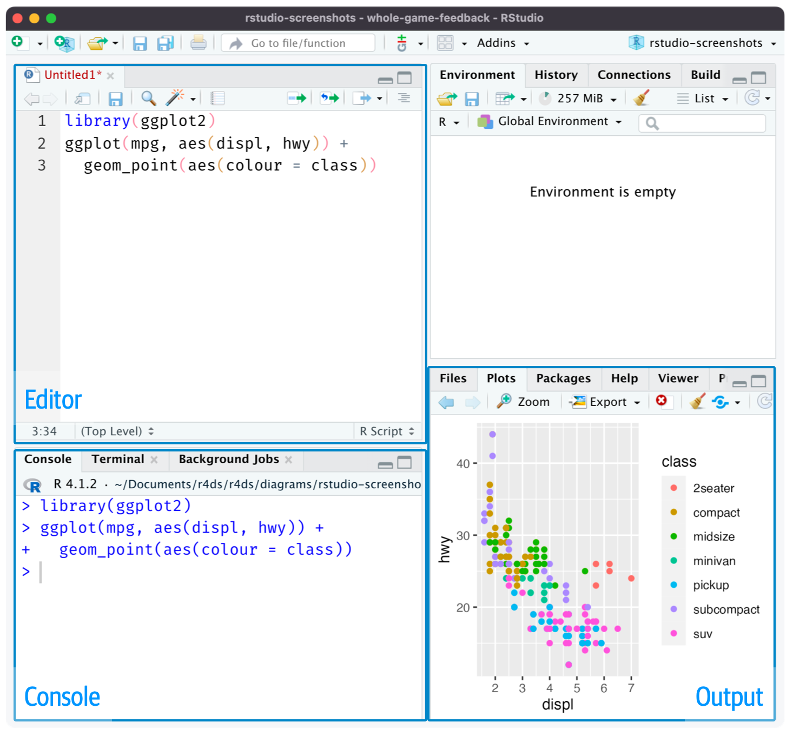

# Source of the slides

The [slides](slides.llms.md) are one Quarto file, `slides.qmd`, shown here as written. R chunks run when the file is rendered, and inline code like `` `r round(avg, 1)` `` puts results into the text. To render it yourself you would also need the data extracts and `_common.R` from this site.

````` markdown
---
pagetitle: "R Recap Before the Lab Exam"   # no built-in title slide: the first slide below is the cover
author: "Lennart Klein"
revealjs-plugins:
  - pointer                          # Q: laser pointer
format:
  revealjs:
    theme: [default, slides.scss]
    slide-number: true
    pdf-max-pages-per-slide: 1   # one PDF page per slide (print with ?print-pdf)
    chalkboard: true             # C: draw on the slide, B: blackboard
    hash-type: number
    preview-links: false              # help sites (rdrr.io) refuse to load inside the slide overlay
    link-external-newwindow: true     # so links open in a new browser tab
    code-copy: true
    code-link: true          # function names link to their help pages (needs downlit + xml2)
    code-overflow: wrap
    code-line-numbers: false   # output splits code into several boxes; numbers would restart at 1 in each
    syntax-highlighting: a11y   # WCAG contrast: readable on projectors and for colour-blind viewers
    width: 1280
    height: 720
    footer: "Quantitative Methods I · Quick R Recap"
  gfm:
    output-file: slides.md   # Markdown with the R output, for LLMs (listed in llms.txt)
    variant: -raw_html       # plain Markdown: drop the layout <div>s and <span>s
execute:
  echo: true
  freeze: auto
  cache: true   # knitr re-runs only changed chunks; delete slides_cache/ after editing data-cleaning code
knitr:
  opts_chunk:
    autodep: true        # a cached chunk re-runs when a chunk it depends on changes
    comment: ""          # results print plainly, as in the Console
    collapse: false      # each result appears below the line that produced it
    fig.width: 7
    fig.height: 3.6
---

```{r}
#| cache: false # side effects or a figure: always run
#| include: false
# static Source Sans 3 (the slide font); the installed variable font renders too thin
systemfonts::register_font(
  name = "Source Sans Static",
  plain = "fonts/SourceSans3-Regular.ttf",
  bold = "fonts/SourceSans3-Semibold.ttf"
)
dataset <- read.csv("data/ess_lab.csv")
dataset$lrscale_clean <- ifelse(
  dataset$lrscale %in% c(77, 88, 99),
  NA,
  dataset$lrscale
)
dataset$age <- ifelse(dataset$agea == 999, NA, dataset$agea)
dataset$edu <- ifelse(
  dataset$eduyrs %in% c(77, 88, 99),
  NA,
  dataset$eduyrs
)
```

## R Recap Before the Lab Exam {.cover .center}

Introduction to Quantitative Methods · Sciences Po

Lennart Klein · 19 November 2026

[Unofficial: not official course material.]{.unofficial}

::: {.follow}
**Follow along:**<br> [quant1.kleinbutsignificant.com/slides.html](https://quant1.kleinbutsignificant.com/slides.html) · [ PDF](slides.pdf){aria-label="Slides as PDF"}
:::

## Today {.center}

::: {.columns}
::: {.column width="50%"}
**By the end you should have**

- an **RStudio** project you can reuse<br> on Tuesday
- a feel for how R reads a line of code
- a routine for fixing errors, with or<br> without AI
:::
::: {.column width="50%"}
**The idea of this session**

- code along and interrupt with any questions
- everything builds on TAs' labs and the lecture
- I am just a nerd who likes to share R <3
- slides are recycled from my time as a TA
:::
:::

## 1 · Setting Up a Project {.center background-color="#1f3a5f"}

##  and RStudio

::: {.columns}
::: {.column width="50%"}
{fig-alt="RStudio with the Editor, Console and Output panes highlighted."}

[Figure: Wickham et al., [*R for Data Science* (2e)](https://r4ds.hadley.nz/workflow-scripts.html), CC BY-NC-ND 3.0]{.figure-credit}
:::
::: {.column width="50%"}
**R** does the statistics. **RStudio** is where you write it.

- **Editor:** your script, the file you hand in
- **Console:** runs R.<br> `>` ready, `+` unfinished line
- **Terminal:** not R, only for setup
- **Environment:** data objects & variables in memory
- **Output:** plots, help, files
:::
:::

## Best Practice: One folder per project

::: {.columns}
::: {.column width="45%"}
A good folder structure (example):
```
labexam/
├── labexam.Rproj    ← double-click
├── data/
│   ├── anes_….csv
│   └── ess.csv
├── output/
└── Lastname_Firstname.R
```
:::
::: {.column width="55%"}
- In **RStudio**, create one with:<br> *File > New Project > New Directory*.
- Opening `labexam.Rproj` automatically makes this folder the working directory.
- `read.csv("data/ess.csv")` then works on any computer, without `setwd()`.
- [TIP] Before you hand in:<br> *Session > Restart R*, then run the whole script again to make sure it works.
:::
:::

## Best Practice: Start every session from a clean slate

By default, **RStudio** saves everything in memory to `.RData` when you quit and loads it again next time. Yesterday's objects come back, and a script can seem to work only because of them.

::: {.columns}
::: {.column width="55%"}
*Tools > Global Options > General*:

- untick **Restore .RData into workspace at startup**
- set **Save workspace to .RData on exit** to **Never**
:::
::: {.column width="45%"}
Or run this once in the Console:

```{r}
#| eval: false
install.packages("usethis")
usethis::use_blank_slate()
```
:::
:::

Your script is what counts. To test it: *Session > Restart R* (Cmd+Shift+0 on a Mac, Ctrl+Shift+F10 on Windows), then run everything from the top.

## The top of your script might look something like this

```{r}
#| eval: false
# Lab exam · Lastname Firstname

library(lmtest)
library(car)
library(margins)
library(nnet)

dataset <- read.csv("data/ess.csv")
dim(dataset)
```

Install the packages once, in the Console (not in the script):

```{r}
#| eval: false
install.packages(c("dplyr", "lmtest", "car", "margins", "nnet"))
```

## 2 · How R Reads Code {.center background-color="#1f3a5f"}

## Three patterns you see in every lab script

| Pattern | Read it as | Example |
|---|---|---|
| `name <- value` | "name gets value" | `x <- c(2, 4, 6)` |
| `function(arguments)` | "do this, with these settings" | `mean(x, na.rm = TRUE)` |
| `dataset$var` | "the column var of dataset" | `dataset$agea` |

```{r}
#| output-location: fragment
x <- c(2, 4, 6)
mean(x)
```

```{r}
dataset$agea[1:6] # [ ] picks elements: here the first six
```

## A condition gives TRUE or FALSE for every row

```{r}
#| output-location: fragment
# one answer per row
head(dataset$agea >= 18)
```

```{r}
# TRUE counts as 1: how many missing codes?
sum(dataset$lrscale %in% c(77, 88, 99))
```

```{r}
#| output-location: fragment
# the share of women
mean(dataset$gndr == 2)
```

## `ifelse()` is Excel's `IF()` for every row

```{r}
#| code-line-numbers: "|2-3|4-5|6-7|10"
dataset$lrscale_clean <- ifelse(
  # condition, checked for every row
  test = dataset$lrscale %in% c(77, 88, 99),
  # value where the condition is TRUE
  yes = NA,
  # value where it is FALSE
  no = dataset$lrscale
)

table(dataset$lrscale_clean, useNA = "ifany")
```

> `useNA` controls if the table includes counts of `NA` values: the allowed values correspond to never (`"no"`), only if the count is positive (`"ifany"`) and even for zero counts (`"always"`). (`?table`)
>
> The default is `"no"`, which would hide the `r format(sum(is.na(dataset$lrscale_clean)), big.mark = ",")` new `NA`s.

## One `NA` makes the result `NA`

```{r}
#| output-location: fragment
mean(c(4, 6, NA))
```

```{r}
#| output-location: fragment
mean(c(4, 6, NA), na.rm = TRUE)
```

- `na.rm = TRUE` in `mean()`, `sd()` and `median()`
- `use = "complete.obs"` in `cor()`
- `lm()` and `glm()` drop incomplete rows on their own and say so: "(… observations deleted due to missingness)"

## Packages

::: {.columns}
::: {.column width="50%"}
| | |
|---|---|
| `install.packages("car")` | downloads it, once per computer |
| `library(car)` | loads it, in every session |
| `car::vif(model)` | uses one function without `library()` |
:::
::: {.column width="50%"}
If R says `could not find function "vif"`, load the package with `library(car)`.

If it says `there is no package called 'car'`, install it first.

Base R functions such as `mean`, `lm` and `t.test` are always available.
:::
:::

## Base R and the tidyverse

::: {.columns}
::: {.column width="50%"}
Base R, as in the labs:

```{r}
#| eval: false
dataset$age_cat <- ifelse(
  dataset$age <= 30,
  0,
  ifelse(dataset$age <= 60, 1, 2)
)
```
:::
::: {.column width="50%"}
dplyr, with the native pipe `|>` ("then"):

```{r}
#| eval: false
dataset <- dataset |>
  mutate(
    age_cat = case_when(
      age <= 30 ~ 0,
      age <= 60 ~ 1,
      age >= 61 ~ 2
    )
  )
```
:::
:::

The Lab 3 solution writes the older pipe `%>%` (from the magrittr package), which does the same here. Both versions give the same variable. Wajd: "THEY WORK THE SAME WAY, so use whichever one you prefer." Base R is closer to the lab scripts, which helps on Tuesday.

## `y ~ x` means "y explained by x"

The same formula works in five functions from the labs:

```{r}
#| eval: false
# means by group
aggregate(lrscale_clean ~ gndr, data = dataset, FUN = mean)

# difference of means
t.test(lrscale_clean ~ gndr, data = dataset)

# figure
boxplot(lrscale_clean ~ gndr, data = dataset)

# regression
lm(lrscale_clean ~ age + factor(gndr) + edu, data = dataset)

# logistic regression (y01 is a 0/1 dummy variable)
glm(y01 ~ age + factor(gndr), data = dataset, family = binomial)
```

> `+` adds a predictor. `*` adds two predictors and their interaction.

## `factor()`: numbers that are labels

```{r}
coef(lm(lrscale_clean ~ factor(gndr), data = dataset))
```

- `gndr` codes 1 = male and 2 = female, so the numbers are categories, not amounts.
- `factor(gndr)2` compares women with men. Men are the reference: the first level, which gets no row of its own.
- `factor(cntry)` adds one dummy per country, compared with AT (first in alphabetical order). These are the country fixed effects.

## 3 · Labs Reworked {.center background-color="#1f3a5f"}

```{r}
#| cache: false # side effects or a figure: always run
#| include: false
source("_common.R") # sig_txt(), r_label(): the course's wording
library(margins)
library(lmtest)
library(car)
library(nnet)
# ANES 2024, cleaned as in Labs 2-3
anes <- read.csv("data/anes_lab.csv")
anes$voted_2024 <- ifelse(
  anes$V242065 == 4,
  1,
  ifelse(anes$V242065 %in% c(1, 2, 3), 0, NA)
)
anes$like_democrat <- ifelse(
  anes$V242432 >= 0 & anes$V242432 <= 10,
  anes$V242432,
  NA
)
anes$age <- ifelse(
  anes$V241458x >= 18 & anes$V241458x <= 80,
  anes$V241458x,
  NA
)
anes$swd <- ifelse(anes$V242439 %in% c(1, 2, 4, 5), anes$V242439, NA)
anes$swd_binary <- ifelse(
  anes$swd %in% c(1, 2),
  1,
  ifelse(anes$swd %in% c(4, 5), 0, NA)
)
# ESS, as in Labs 4-5
dataset$far_right <- ifelse(
  dataset$lrscale_clean >= 8,
  1,
  ifelse(dataset$lrscale_clean <= 7, 0, NA)
)
anes$gender <- ifelse(
  anes$V241551 %in% c(1, 2, 3, 4),
  anes$V241551,
  NA
)
ess <- dataset # Labs 2-3 call the ANES data `dataset` too: switch at each lab
```

## Lab 2 {.center background-color="#dce6f2"}

Describe variables and their associations · ANES 2024

```{r}
#| include: false
dataset <- anes # Labs 2-3: the ANES data, called dataset as in the lab scripts
```

## Frequency table (Lab 2)

```{r}
table(dataset$voted_2024)
```

```{r}
#| include: false
vt <- table(dataset$voted_2024)
vp <- round(100 * prop.table(vt), 1)
```

::: {.example-interp}
Most respondents voted in 2024: `r format(vt[["1"]], big.mark = ",")` of `r format(sum(vt), big.mark = ",")`, or `r vp[["1"]]`%. The mode is "voted".
:::

::: {.interp-note}
In the output: `0` = did not vote, `1` = voted, with the number of respondents below. `prop.table(table(dataset$voted_2024))` gives the shares.
:::

## Describe a variable (Lab 2)

```{r}
mean(dataset$like_democrat, na.rm = TRUE)
sd(dataset$like_democrat, na.rm = TRUE)
median(dataset$like_democrat, na.rm = TRUE)
```

```{r}
#| include: false
ld_mean <- mean(dataset$like_democrat, na.rm = TRUE)
ld_sd <- sd(dataset$like_democrat, na.rm = TRUE)
ld_med <- median(dataset$like_democrat, na.rm = TRUE)
```

::: {.example-interp}
- **Centre:** on average, respondents rate the Democratic Party `r format(round(ld_mean, 2), nsmall = 2)` out of 10 (median `r ld_med`).
- **Shape:** the mean and the median are very close, so the distribution is approximately symmetric.
- **Spread:** the standard deviation (`r format(round(ld_sd, 2), nsmall = 2)`) is large compared with the mean: the ratings are widely spread.
:::

::: {.interp-note}
In the output: `[1]` only numbers the first value of the result. `na.rm = TRUE` leaves out the missing values.
:::

## Histogram (Lab 2)

```{r}
#| cache: false # side effects or a figure: always run
#| label: plot-histogram
#| fig-width: 9
#| fig-height: 4.6
#| out-width: "78%"
hist(dataset$like_democrat)
```

The bars show the shape that the mean and median describe. The first bar counts the 0s and the 1s together. `breaks = seq(-0.5, 10.5, by = 1)` gives one bar per value.

## Describe a variable (Lab 2) – as a figure

::: {.columns}
::: {.column width="66%"}
```{r}
#| cache: false # side effects or a figure: always run
#| label: plot-density
#| echo: false
#| fig-width: 8
#| fig-height: 6.2
#| out-width: "100%"
#| dev: "ragg_png"
ld <- dataset$like_democrat[!is.na(dataset$like_democrat)]
mu <- mean(ld)
s_d <- sd(ld)
md <- median(ld)
dens <- ggplot2::layer_data(
  ggplot2::ggplot(data.frame(v = ld), ggplot2::aes(v)) +
    ggplot2::geom_density(bounds = c(0, 10), adjust = 1.2)
)
band <- dens[dens$x >= mu - s_d & dens$x <= mu + s_d, ]
ggplot2::ggplot(dens, ggplot2::aes(x = x, y = y)) +
  ggplot2::geom_area(data = band, fill = "grey85") +
  ggplot2::geom_line(linewidth = 1.2) +
  ggplot2::geom_vline(xintercept = mu, linewidth = 1) +
  ggplot2::geom_vline(
    xintercept = md,
    linetype = "22",
    linewidth = 1
  ) +
  ggplot2::annotate(
    "text",
    x = mu - 0.15,
    y = max(dens$y) * 1.04,
    label = paste0("Mean ", format(round(mu, 2), nsmall = 2)),
    hjust = 1,
    size = 6.5,
    family = "Source Sans Static"
  ) +
  ggplot2::annotate(
    "text",
    x = md + 0.15,
    y = max(dens$y) * 1.04,
    label = paste0("Median ", md),
    hjust = 0,
    size = 6.5,
    family = "Source Sans Static"
  ) +
  ggplot2::scale_x_continuous(breaks = 0:10) +
  ggplot2::scale_y_continuous(
    labels = function(x) paste0(round(100 * x), "%"),
    expand = ggplot2::expansion(mult = c(0, 0.12))
  ) +
  ggplot2::labs(
    x = "Rating of the Democratic Party (0-10)",
    y = "Share of respondents"
  ) +
  ggplot2::theme_minimal(
    base_size = 21,
    base_family = "Source Sans Static"
  ) +
  ggplot2::theme(
    text = ggplot2::element_text(colour = "black"),
    axis.text = ggplot2::element_text(colour = "black"),
    panel.grid.minor = ggplot2::element_blank(),
    panel.grid.major.x = ggplot2::element_blank(),
    panel.grid.major.y = ggplot2::element_line(
      colour = "grey88",
      linewidth = 0.3
    ),
    axis.line.x = ggplot2::element_line(
      colour = "black",
      linewidth = 0.4
    )
  )
```
:::
::: {.column width="34%" .fe-note}
- **Curve**: how common each rating is (smoothed).
- **Mean** and **median** almost coincide: the distribution is roughly symmetric.
- **Shaded**: mean ± 1 standard deviation, from `r format(round(mean(dataset$like_democrat, na.rm = TRUE) - sd(dataset$like_democrat, na.rm = TRUE), 1), nsmall = 1)` to `r format(round(mean(dataset$like_democrat, na.rm = TRUE) + sd(dataset$like_democrat, na.rm = TRUE), 1), nsmall = 1)`. It holds `r round(100 * mean(abs(dataset$like_democrat - mean(dataset$like_democrat, na.rm = TRUE)) <= sd(dataset$like_democrat, na.rm = TRUE), na.rm = TRUE))`% of respondents: a large spread.
:::
:::

## Crosstab (Lab 2)

```{r}
table(dataset$voted_2024, dataset$gender)
```

```{r}
#| include: false
ct <- round(
  100 * prop.table(table(dataset$voted_2024, dataset$gender), 2),
  1
)
```

::: {.example-interp}
Men and women voted at about the same rate: `r ct["1", "1"]`% of men and `r ct["1", "2"]`% of women. Gender makes little difference to voting in this sample.
:::

::: {.interp-note}
In the output: rows = voted (0 no, 1 yes), columns = gender (1 man, 2 woman, 3 nonbinary, 4 something else). These are counts: `prop.table(table(...), margin = 2)` gives the share of each column.
:::

## Group means (Lab 2)

```{r}
aggregate(like_democrat ~ voted_2024, data = dataset, FUN = mean)
```

```{r}
#| include: false
gm <- aggregate(
  like_democrat ~ voted_2024,
  data = dataset,
  FUN = mean
)
```

::: {.example-interp}
Voters rate the Democratic Party higher than non-voters: `r format(round(gm$like_democrat[2], 2), nsmall = 2)` against `r format(round(gm$like_democrat[1], 2), nsmall = 2)` out of 10. The difference in the means suggests an association between voting and the rating of the Democratic Party in this sample.
:::

::: {.interp-note}
In the output: one row per group, `0` = did not vote, `1` = voted. Whether the difference holds in the population is what the t-test checks (Lab 3).
:::

## Correlation (Lab 2)

```{r}
cor(dataset$like_democrat, dataset$age, use = "complete.obs")
```

```{r}
#| include: false
r_lab <- cor(dataset$like_democrat, dataset$age, use = "complete.obs")
```

::: {.example-interp}
There is a `r r_dir(r_lab)` but `r r_label(r_lab)` association between age and the rating of the Democratic Party (r = `r format(round(r_lab, 2), nsmall = 2)`): age makes almost no difference to it.
:::

::: {.interp-note}
Strength (Lecture 4): |r| below 0.10 negligible, from 0.10 weak, 0.30 moderate, 0.50 strong, 0.75 very strong. `use = "complete.obs"` leaves out respondents with a missing value.
:::

## Scatter plot (Lab 2)

```{r}
#| cache: false # side effects or a figure: always run
#| label: plot-scatter
#| fig-width: 9
#| fig-height: 4.6
#| out-width: "78%"
plot(dataset$age, dataset$like_democrat)
```

::: {.interp-note}
Each dot is a respondent. The ratings are whole numbers, so the dots fall in rows and hide each other. No slope is visible: the same as r = `r format(round(r_lab, 2), nsmall = 2)`.
:::

## Lab 3 {.center background-color="#dce6f2"}

t-test and chi-square test · ANES 2024

## t-test (Lab 3)

```{r}
t.test(dataset$swd ~ dataset$voted_2024)
```

```{r}
#| include: false
tt <- t.test(dataset$swd ~ dataset$voted_2024)
```

::: {.example-interp}
Voters are more satisfied with democracy than non-voters: their mean is `r format(round(tt$estimate[[2]], 2), nsmall = 2)` against `r format(round(tt$estimate[[1]], 2), nsmall = 2)` (lower = more satisfied), a difference of `r format(round(tt$estimate[[1]] - tt$estimate[[2]], 2), nsmall = 2)`. The difference is `r sig_txt(tt$p.value)`: we reject the null hypothesis that the means are equal.
:::

::: {.interp-note}
In the output: `mean in group 0` = non-voters, `group 1` = voters. `p-value` = `r signif(tt$p.value, 2)`. The 95% confidence interval of the difference does not include 0.
:::

## Boxplot (Lab 3)

```{r}
#| cache: false # side effects or a figure: always run
#| label: plot-boxplot
#| fig-width: 9
#| fig-height: 4.6
#| out-width: "78%"
boxplot(dataset$swd ~ dataset$voted_2024)
```

::: {.interp-note}
The thick line is the median, the box holds the middle half of the respondents. `swd` has only four values (1, 2, 4, 5), so both boxes look alike: the medians are both 2. The means (t-test) show the difference better, as on the next slide.
:::

## t-test (Lab 3) – as a figure

::: {.columns}
::: {.column width="66%"}
```{r}
#| cache: false # side effects or a figure: always run
#| label: plot-ttest
#| echo: false
#| fig-width: 8
#| fig-height: 6.2
#| out-width: "100%"
#| dev: "ragg_png"
ci_group <- function(g) {
  t <- t.test(dataset$swd[dataset$voted_2024 == g])
  data.frame(
    mean = t$estimate,
    low = t$conf.int[1],
    high = t$conf.int[2]
  )
}
tg <- rbind(ci_group(0), ci_group(1))
tg$group <- factor(
  c("Non-voters", "Voters"),
  levels = c("Voters", "Non-voters")
)
ggplot2::ggplot(tg, ggplot2::aes(x = mean, y = group)) +
  ggplot2::geom_errorbar(
    ggplot2::aes(xmin = low, xmax = high),
    width = 0.12,
    orientation = "y",
    linewidth = 0.8
  ) +
  ggplot2::geom_point(size = 4) +
  ggplot2::geom_text(
    ggplot2::aes(label = format(round(mean, 2), nsmall = 2)),
    nudge_y = 0.22,
    size = 7,
    family = "Source Sans Static"
  ) +
  ggplot2::scale_x_continuous(
    limits = c(2.4, 3.2),
    breaks = seq(2.4, 3.2, 0.2)
  ) +
  ggplot2::labs(
    x = "Mean satisfaction (1 = very satisfied ... 5 = not at all)",
    y = NULL
  ) +
  ggplot2::theme_minimal(
    base_size = 21,
    base_family = "Source Sans Static"
  ) +
  ggplot2::theme(
    text = ggplot2::element_text(colour = "black"),
    axis.text = ggplot2::element_text(colour = "black"),
    panel.grid.minor = ggplot2::element_blank(),
    panel.grid.major.y = ggplot2::element_blank(),
    panel.grid.major.x = ggplot2::element_line(
      colour = "grey88",
      linewidth = 0.3
    ),
    axis.line.x = ggplot2::element_line(
      colour = "black",
      linewidth = 0.4
    )
  )
```
:::
::: {.column width="34%" .fe-note}
- Dot: the mean of each group. Line: its 95% confidence interval.
- The intervals don't overlap: the difference is statistically significant.
- Lower means **more** satisfied: voters are more satisfied.
:::
:::

## Chi-square test (Lab 3)

```{r}
table(dataset$swd_binary, dataset$voted_2024)
chisq.test(dataset$swd_binary, dataset$voted_2024)
```

```{r}
#| include: false
tab <- table(dataset$swd_binary, dataset$voted_2024)
chi <- chisq.test(dataset$swd_binary, dataset$voted_2024)
pct <- round(prop.table(tab, margin = 2) * 100)
```

::: {.example-interp}
Voters are more often satisfied with democracy: `r pct["1", "1"]`% of voters against `r pct["1", "0"]`% of non-voters. The association is `r sig_txt(chi$p.value)`: we reject the null hypothesis of no association between voting and satisfaction.
:::

::: {.interp-note}
In the output: rows = satisfied (1) or not (0), columns = voted (1) or not (0). The test gives significance only. The direction comes from the percentages, `prop.table(table(...), margin = 2)`. X-squared = `r round(chi$statistic, 1)`.
:::

## Chi-square test (Lab 3) – as a figure

::: {.columns}
::: {.column width="66%"}
```{r}
#| cache: false # side effects or a figure: always run
#| label: plot-chisq
#| echo: false
#| fig-width: 8
#| fig-height: 6.2
#| out-width: "100%"
#| dev: "ragg_png"
ok <- !is.na(dataset$swd_binary) & !is.na(dataset$voted_2024)
cg <- data.frame(
  group = factor(
    c("Non-voters", "Voters"),
    levels = c("Voters", "Non-voters")
  ),
  pct = c(
    100 * mean(dataset$swd_binary[ok & dataset$voted_2024 == 0]),
    100 * mean(dataset$swd_binary[ok & dataset$voted_2024 == 1])
  )
)
overall <- 100 * mean(dataset$swd_binary[ok])
ggplot2::ggplot(cg, ggplot2::aes(x = pct, y = group)) +
  ggplot2::geom_col(width = 0.5, fill = "grey70") +
  ggplot2::geom_text(
    ggplot2::aes(label = paste0(round(pct), "%")),
    hjust = -0.15,
    size = 7,
    family = "Source Sans Static"
  ) +
  ggplot2::geom_vline(
    xintercept = overall,
    linetype = "22",
    linewidth = 0.8
  ) +
  ggplot2::annotate(
    "text",
    x = overall + 1.5,
    y = 2.6,
    label = paste0("All: ", round(overall), "%"),
    hjust = 0,
    size = 6.5,
    family = "Source Sans Static"
  ) +
  ggplot2::scale_x_continuous(
    limits = c(0, 100),
    breaks = seq(0, 100, 25),
    labels = function(x) paste0(x, "%"),
    expand = ggplot2::expansion(mult = c(0, 0.02))
  ) +
  ggplot2::scale_y_discrete(
    expand = ggplot2::expansion(add = c(0.5, 0.8))
  ) +
  ggplot2::labs(x = "Satisfied with democracy", y = NULL) +
  ggplot2::theme_minimal(
    base_size = 21,
    base_family = "Source Sans Static"
  ) +
  ggplot2::theme(
    text = ggplot2::element_text(colour = "black"),
    axis.text = ggplot2::element_text(colour = "black"),
    panel.grid.minor = ggplot2::element_blank(),
    panel.grid.major.y = ggplot2::element_blank(),
    panel.grid.major.x = ggplot2::element_line(
      colour = "grey88",
      linewidth = 0.3
    ),
    axis.line.x = ggplot2::element_line(
      colour = "black",
      linewidth = 0.4
    )
  )
```
:::
::: {.column width="34%" .fe-note}
- Bars: the share satisfied in each group.
- Dashed line: what both groups would show with **no association** (the null hypothesis).
- Chi-square measures how far the groups are from that line. The bars give the direction.
:::
:::

## Lab 4 {.center background-color="#dce6f2"}

Linear regression, country fixed effects and diagnostics · ESS round 11

```{r}
#| include: false
dataset <- ess # Labs 4-5: back to the ESS data
```

## OLS regression (Lab 4)

```{r}
#| eval: false
model1 <- lm(lrscale_clean ~ age + factor(gndr) + edu, data = dataset)
summary(model1)
```

```{r}
#| echo: false
model1 <- lm(lrscale_clean ~ age + factor(gndr) + edu, data = dataset)
printCoefmat(coef(summary(model1)), digits = 3, signif.legend = FALSE)
```

::: {.example-interp}
- **Education:** the more educated, the more to the left. One more year of education lowers left-right self-placement by `r format(abs(round(coef(model1)[["edu"]], 3)), nsmall = 3)` points, net of age and gender (`r sig(model1, "edu")`).
- **Gender:** women place themselves `r format(abs(round(coef(model1)[["factor(gndr)2"]], 2)), nsmall = 2)` points further left than men (`r sig(model1, "factor(gndr)2")`).
- **Age:** older people place themselves slightly further right, `r format(round(coef(model1)[["age"]], 3), nsmall = 3)` points per year (`r sig(model1, "age")`).
:::

::: {.interp-note}
In the output: `Estimate` gives the direction (sign) and the size, `Pr(>|t|)` the p-value. R² = `r round(summary(model1)$r.squared, 3)`: together the variables explain `r round(100 * summary(model1)$r.squared, 1)`% of the variance.
:::

## OLS regression (Lab 4) – as a figure

::: {.columns}
::: {.column width="66%"}
```{r}
#| cache: false # side effects or a figure: always run
#| label: plot-ols
#| echo: false
#| message: false
#| warning: false
#| fig-width: 8
#| fig-height: 6.2
#| out-width: "100%"
#| dev: "ragg_png"
bm <- aggregate(lrscale_clean ~ edu, data = dataset, FUN = mean)
bm <- bm[bm$edu >= 4 & bm$edu <= 24, ]
# prediction averaged over gender (like the dots), at the mean age of the model sample
mf <- model.frame(model1)
w_women <- mean(mf[["factor(gndr)"]] == "2")
nd <- expand.grid(edu = 4:24, gndr = c(1, 2), age = mean(mf$age))
nd$p <- predict(model1, newdata = nd)
line_ols <- data.frame(
  edu = 4:24,
  Predicted = (1 - w_women) *
    nd$p[nd$gndr == 1] +
    w_women * nd$p[nd$gndr == 2]
)
ggplot2::ggplot() +
  ggplot2::geom_point(
    data = bm,
    ggplot2::aes(x = edu, y = lrscale_clean),
    size = 3.5,
    colour = "grey50"
  ) +
  ggplot2::geom_line(
    data = line_ols,
    ggplot2::aes(x = edu, y = Predicted),
    linewidth = 1.3
  ) +
  ggplot2::scale_x_continuous(breaks = seq(4, 24, 4)) +
  ggplot2::labs(
    x = "Years of education",
    y = "Left-right (0 = left, 10 = right)"
  ) +
  ggplot2::theme_minimal(
    base_size = 21,
    base_family = "Source Sans Static"
  ) +
  ggplot2::theme(
    text = ggplot2::element_text(colour = "black"),
    axis.text = ggplot2::element_text(colour = "black"),
    panel.grid.minor = ggplot2::element_blank(),
    panel.grid.major.x = ggplot2::element_blank(),
    panel.grid.major.y = ggplot2::element_line(
      colour = "grey88",
      linewidth = 0.3
    ),
    axis.line.x = ggplot2::element_line(
      colour = "black",
      linewidth = 0.4
    )
  )
```
:::
::: {.column width="34%" .fe-note}
- Dots: the average left-right position for each year of education.
- Line: the regression's prediction. Its slope is the education coefficient, `r format(round(coef(model1)[["edu"]], 3), nsmall = 3)` per year, net of age and gender.
- The line summarises the dots. It doesn't pass through each one.
- [How this plot is built, layer by layer](animations/ggplot2-ols.html) (animated)
:::
:::

## Country fixed effects (Lab 4)

```{r}
#| eval: false
model2 <- lm(
  lrscale_clean ~ age + factor(gndr) + edu + factor(cntry),
  data = dataset
)
summary(model2)
```

```{r}
#| echo: false
model2 <- lm(
  lrscale_clean ~ age + factor(gndr) + edu + factor(cntry),
  data = dataset
)
printCoefmat(
  coef(summary(model2))[2:4, ],
  digits = 3,
  signif.legend = FALSE
)
```

::: {.example-interp}
Net of the differences between countries, the effects barely change: one more year of education lowers left-right self-placement by `r format(abs(round(coef(model2)[["edu"]], 3)), nsmall = 3)` points, and women place themselves `r format(abs(round(coef(model2)[["factor(gndr)2"]], 2)), nsmall = 2)` points further left than men (both `r sig(model2, "edu")`).
:::

::: {.interp-note}
In the output: each respondent is now compared with others from the same country. The country rows (`factor(cntry)BE`, …) compare each country with Austria. R² rises from `r round(summary(model1)$r.squared, 3)` to `r round(summary(model2)$r.squared, 3)`: the countries explain part of the variance.
:::

## Country fixed effects (Lab 4) – as a figure

::: {.columns}
::: {.column width="66%"}
```{r}
#| cache: false # side effects or a figure: always run
#| label: plot-fixed-effects
#| echo: false
#| message: false
#| warning: false
#| fig-width: 8
#| fig-height: 6.2
#| out-width: "100%"
#| dev: "ragg_png"
grid_fe <- expand.grid(
  edu = 4:24,
  cntry = sort(unique(dataset$cntry)),
  gndr = 1,
  age = mean(dataset$age, na.rm = TRUE),
  stringsAsFactors = FALSE
)
grid_fe$Predicted <- predict(model2, newdata = grid_fe)
cnames <- c(
  AT = "Austria",
  BE = "Belgium",
  BG = "Bulgaria",
  CH = "Switzerland",
  CY = "Cyprus",
  DE = "Germany",
  EE = "Estonia",
  ES = "Spain",
  FI = "Finland",
  FR = "France",
  GR = "Greece",
  HR = "Croatia",
  HU = "Hungary",
  IE = "Ireland",
  IT = "Italy",
  LT = "Lithuania",
  LV = "Latvia",
  NL = "Netherlands",
  PL = "Poland",
  PT = "Portugal",
  SE = "Sweden",
  SI = "Slovenia",
  SK = "Slovakia"
)
base_fe <- grid_fe[grid_fe$edu == 4, ]
hi <- base_fe$cntry[which.max(base_fe$Predicted)]
lo <- base_fe$cntry[which.min(base_fe$Predicted)]
show <- cnames[unique(c(hi, "FR", lo))]
grid_fe$hl <- grid_fe$cntry %in% names(show)
ends_fe <- grid_fe[grid_fe$hl & grid_fe$edu == 24, ]
ends_fe$label <- show[ends_fe$cntry]
ggplot2::ggplot(
  grid_fe,
  ggplot2::aes(x = edu, y = Predicted, group = cntry)
) +
  ggplot2::geom_line(
    data = grid_fe[!grid_fe$hl, ],
    colour = "grey80",
    linewidth = 0.6
  ) +
  ggplot2::geom_line(
    data = grid_fe[grid_fe$hl, ],
    colour = "black",
    linewidth = 1.2
  ) +
  ggplot2::geom_text(
    data = ends_fe,
    ggplot2::aes(label = label),
    hjust = 0,
    nudge_x = 0.4,
    size = 7,
    family = "Source Sans Static"
  ) +
  ggplot2::scale_x_continuous(
    breaks = seq(4, 24, 4),
    expand = ggplot2::expansion(mult = c(0.02, 0.01))
  ) +
  ggplot2::labs(
    x = "Years of education",
    y = "Left-right (0 = left, 10 = right)"
  ) +
  ggplot2::theme_minimal(
    base_size = 21,
    base_family = "Source Sans Static"
  ) +
  ggplot2::coord_cartesian(clip = "off") +
  ggplot2::theme(
    text = ggplot2::element_text(colour = "black"),
    axis.text = ggplot2::element_text(colour = "black"),
    panel.grid.minor = ggplot2::element_blank(),
    panel.grid.major.x = ggplot2::element_blank(),
    panel.grid.major.y = ggplot2::element_line(
      colour = "grey88",
      linewidth = 0.3
    ),
    axis.line.x = ggplot2::element_line(
      colour = "black",
      linewidth = 0.4
    ),
    plot.margin = ggplot2::margin(10, 110, 10, 10)
  )
```
:::
::: {.column width="34%" .fe-note}
- Each line is one country.
- Different heights: each country has its own baseline. That baseline is the **fixed effect**.
- Parallel lines: one education effect, estimated **within** countries.
:::
:::

## One country only: France (Lab 4)

```{r}
#| eval: false
dataset_france <- subset(dataset, cntry == "FR")
model_france <- lm(
  lrscale_clean ~ age + factor(gndr) + edu,
  data = dataset_france
)
summary(model_france)
```

```{r}
#| echo: false
dataset_france <- subset(dataset, cntry == "FR")
model_france <- lm(
  lrscale_clean ~ age + factor(gndr) + edu,
  data = dataset_france
)
printCoefmat(
  coef(summary(model_france)),
  digits = 3,
  signif.legend = FALSE
)
```

::: {.example-interp}
In France, older people place themselves further right (`r format(round(coef(model_france)[["age"]], 3), nsmall = 3)` points per year) and women `r format(abs(round(coef(model_france)[["factor(gndr)2"]], 2)), nsmall = 2)` points further left than men (both `r sig(model_france, "age")`). Education goes with a more left-wing placement, `r format(abs(round(coef(model_france)[["edu"]], 3)), nsmall = 3)` points per year, but only `r sig(model_france, "edu")`.
:::

::: {.interp-note}
In the output: the model uses only the `r format(nobs(model_france), big.mark = ",")` French respondents, so the standard errors are larger than with all countries.
:::

## Residual plot (Lab 4)

```{r}
#| cache: false # side effects or a figure: always run
#| label: plot-residuals
#| fig-width: 9
#| fig-height: 4.6
#| out-width: "78%"
plot(model2$fitted.values, model2$residuals)
abline(h = 0)
```

::: {.interp-note}
Each dot is a respondent: the model's prediction (x) against its error (y). If the vertical spread changes from left to right, the residuals are heteroskedastic. The diagonal stripes come from `lrscale` taking only whole values from 0 to 10. The Breusch-Pagan test on the next slide checks it formally.
:::

## Heteroskedasticity (Lab 4)

```{r}
bptest(model2)
```

```{r}
#| include: false
bp <- bptest(model2)
```

::: {.example-interp}
We reject the null hypothesis of homoskedasticity (`r sig_txt(bp$p.value)`): the residuals are heteroskedastic. Their variance is not the same across the fitted values, so the usual standard errors are not reliable. The course's fix: robust standard errors.
:::

::: {.interp-note}
In the output: BP = `r round(bp$statistic)`, df = `r bp$parameter` (the number of independent variables, with the 22 country dummies). The null hypothesis is homoskedasticity, so a small p-value means heteroskedasticity.
:::

## Heteroskedasticity (Lab 4) – as a figure

::: {.columns}
::: {.column width="66%"}
```{r}
#| cache: false # side effects or a figure: always run
#| label: plot-heteroskedasticity
#| echo: false
#| fig-width: 8
#| fig-height: 5.6
#| out-width: "100%"
#| dev: "ragg_png"
# simulated illustration: same line, equal vs growing spread
set.seed(1)
n_sim <- 150
x_sim <- runif(n_sim, 0, 10)
sim <- rbind(
  data.frame(
    x = x_sim,
    y = 2 + 0.5 * x_sim + rnorm(n_sim, sd = 1),
    panel = "Equal spread"
  ),
  data.frame(
    x = x_sim,
    y = 2 + 0.5 * x_sim + rnorm(n_sim, sd = 0.15 + 0.3 * x_sim),
    panel = "Spread grows"
  )
)
ggplot2::ggplot(sim, ggplot2::aes(x = x, y = y)) +
  ggplot2::geom_point(size = 1.8, colour = "grey55") +
  ggplot2::geom_abline(intercept = 2, slope = 0.5, linewidth = 1.2) +
  ggplot2::facet_wrap(~panel) +
  ggplot2::labs(x = "X", y = "Y") +
  ggplot2::theme_minimal(
    base_size = 21,
    base_family = "Source Sans Static"
  ) +
  ggplot2::theme(
    text = ggplot2::element_text(colour = "black"),
    strip.text = ggplot2::element_text(
      colour = "black",
      size = 21,
      hjust = 0
    ),
    axis.text = ggplot2::element_blank(),
    panel.grid = ggplot2::element_blank(),
    axis.line = ggplot2::element_line(
      colour = "black",
      linewidth = 0.4
    ),
    panel.spacing = ggplot2::unit(2, "lines")
  )
```

[Simulated data, for illustration.]{.figure-credit}
:::
::: {.column width="34%" .fe-note}
- Each dot is a person, the line is the regression's prediction.
- Left: the line is equally good for everyone. Right: the further right, the more people are off the line.
- Why it's bad: the line is still right, but the usual standard errors are wrong, so the p-values can't be trusted.
- Our model is like the right one (Breusch-Pagan test). Fix: robust standard errors.
:::
:::

## Multicollinearity (Lab 4)

```{r}
vif(model2)
```

::: {.example-interp}
All the VIFs are close to 1 (at most `r round(max(vif(model2)[, 1]), 2)`), well below 10: multicollinearity is not a concern.
:::

::: {.interp-note}
In the output: for `factor(cntry)`, which has many categories, read the last column, `GVIF^(1/(2*Df))`.
:::

## Multicollinearity (Lab 4) – as a figure

::: {.columns}
::: {.column width="66%"}
```{r}
#| cache: false # side effects or a figure: always run
#| label: plot-vif
#| echo: false
#| fig-width: 8
#| fig-height: 6.2
#| out-width: "100%"
#| dev: "ragg_png"
v <- vif(model2)
vd <- data.frame(
  var = factor(
    c("Age", "Gender", "Education", "Country"),
    levels = rev(c("Age", "Gender", "Education", "Country"))
  ),
  vif = v[, "GVIF"]
)
ggplot2::ggplot(vd, ggplot2::aes(x = vif, y = var)) +
  ggplot2::geom_col(width = 0.5, fill = "grey70") +
  ggplot2::geom_text(
    ggplot2::aes(label = format(round(vif, 2), nsmall = 2)),
    hjust = -0.2,
    size = 6.5,
    family = "Source Sans Static"
  ) +
  ggplot2::geom_vline(
    xintercept = 10,
    linetype = "22",
    linewidth = 0.8
  ) +
  ggplot2::annotate(
    "text",
    x = 9.8,
    y = 4.45,
    label = "Concern from 10",
    hjust = 1,
    size = 6,
    family = "Source Sans Static"
  ) +
  ggplot2::scale_x_continuous(
    limits = c(0, 11),
    breaks = c(0, 1, 5, 10),
    expand = ggplot2::expansion(mult = c(0, 0.02))
  ) +
  ggplot2::scale_y_discrete(
    expand = ggplot2::expansion(add = c(0.5, 0.8))
  ) +
  ggplot2::labs(x = "Variance inflation factor (VIF)", y = NULL) +
  ggplot2::theme_minimal(
    base_size = 21,
    base_family = "Source Sans Static"
  ) +
  ggplot2::theme(
    text = ggplot2::element_text(colour = "black"),
    axis.text = ggplot2::element_text(colour = "black"),
    panel.grid.minor = ggplot2::element_blank(),
    panel.grid.major.y = ggplot2::element_blank(),
    panel.grid.major.x = ggplot2::element_line(
      colour = "grey88",
      linewidth = 0.3
    ),
    axis.line.x = ggplot2::element_line(
      colour = "black",
      linewidth = 0.4
    )
  )
```
:::
::: {.column width="34%" .fe-note}
- VIF: how much a variable is explained by the other independent variables.
- Why it's bad: if variables overlap, the model can't tell their effects apart. The standard errors get large, so real effects can look not significant.
- 1 means no overlap. Below 10 is generally not a concern. All four are about 1: no multicollinearity.
:::
:::

## Lab 5 {.center background-color="#dce6f2"}

Logit, marginal effects, multinomial logit and interactions · ESS round 11.

```{r}
#| include: false
m <- model1 # Lab 4's models, kept for the easystats slides
m_fe <- model2
```

## Recoding in base R (Lab 5, Step 2)

```{r}
#| eval: false
# 1 = far right (8-10), 0 = the rest (0-7)
dataset$far_right <- ifelse(
  dataset$lrscale_clean >= 8 & dataset$lrscale_clean <= 10,
  1,
  ifelse(
    dataset$lrscale_clean >= 0 & dataset$lrscale_clean <= 7,
    0,
    NA
  )
)
```

**Nested `ifelse()`:** if 8 to 10, then 1. Otherwise, if 0 to 7, then 0. Otherwise `NA`. The second `ifelse()` is the "no" of the first.

The next slide does the same with dplyr.

## The same thing but tidier: Recoding with dplyr

:::: {.columns}
::: {.column width="62%"}
```{r}
#| cache: false # side effects or a figure: always run
#| message: false
library(dplyr)
dataset <- dataset |>
  mutate(
    # condition ~ new value, one line per group
    far_right = case_when(
      between(lrscale_clean, 8, 10) ~ 1,
      between(lrscale_clean, 0, 7) ~ 0,
      .default = NA
    )
  )
dataset |> count(far_right) # check
```
:::
::: {.column width="38%" .fe-note}
- One line per group, like the codebook. `between(x, 8, 10)` means 8 ≤ x ≤ 10.
- `.default = NA`: anything that matches no line (a missing code, `NA`) becomes `NA`.
- `count()` checks the result, like `table(x, useNA = "ifany")`.
:::
::::

## Logit output (Lab 5, Step 2)

```{r}
#| eval: false
summary(logit1) # far_right ~ age + factor(gndr) + edu + factor(cntry)
```

```{r}
#| echo: false
logit1 <- glm(
  far_right ~ age + factor(gndr) + edu + factor(cntry),
  data = dataset,
  family = binomial
)
cf1 <- coef(summary(logit1))
printCoefmat(cf1[1:6, ], digits = 3, signif.legend = FALSE)
```

::: {.example-interp}
- **Gender:** women are less likely than men to place themselves on the far right (`r sig(logit1, "factor(gndr)2")`).
- **Age:** older people are more likely (`r sig(logit1, "age")`).
- **Education:** the more educated, the less likely (`r sig(logit1, "edu")`).
:::

::: {.interp-note}
In the output: in a logit, only the sign of `Estimate` is interpreted. The size comes from the marginal effects. `factor(gndr)2` = women vs men (the reference has no row), `factor(cntry)BE` = Belgium vs Austria. Stars: R's `***` 0.001, `**` 0.01, `*` 0.05 are not the course's 0.01, 0.05, 0.10 (Lecture 8, slide 41): go by the p-value.
:::

## One effect, three numbers (Lab 5)

```{r}
#| include: false
me_overview <- summary(margins(logit1))
ame_women <- me_overview$AME[me_overview$factor == "gndr2"]
```

The same model, the same effect of being a woman, on three scales:

:::: {.columns}
::: {.column width="33%"}
**Log-odds**<br> `summary(logit1)`

[`r format(round(cf1["factor(gndr)2", 1], 2), nsmall = 2)`]{.big-number}

Only the sign: women are less likely to be on the far right.
:::
::: {.column width="33%"}
**Odds ratio**<br> `exp(coef(logit1))`

[`r format(round(exp(cf1["factor(gndr)2", 1]), 2), nsmall = 2)`]{.big-number}

Women's odds are `r round(100 * (1 - exp(cf1["factor(gndr)2", 1])))`% lower.
:::
::: {.column width="33%"}
**Marginal effect**<br> `summary(margins(logit1))`

[`r format(round(ame_women, 3), nsmall = 3)`]{.big-number}

× 100: women are `r format(abs(round(100 * ame_women, 1)), nsmall = 1)` percentage points less likely.
:::
::::

::: {.interp-note}
In the exam: the direction and significance from `summary()`, the size from the marginal effects.
:::

## Log-odds and odds ratios (beyond the course)

```{r}
exp(coef(logit1))[c("age", "factor(gndr)2", "edu")]
```

```{r}
#| include: false
or_w <- exp(coef(logit1))[["factor(gndr)2"]]
```

- **`summary(logit1)` gives log-odds:** the change in log(p / (1 − p)) when X goes up by one. That is hard to read, so the course reads only the sign (Lecture 10).
- **`exp()` turns them into odds ratios.** Above 1: higher odds. Below 1: lower odds. Women: `r format(round(or_w, 2), nsmall = 2)`, so their odds of being on the far right are `r round(100 * (1 - or_w))`% lower than men's.
- **Odds are not probabilities.** For the size, the course uses the marginal effects, in percentage points (the marginal effects slide).

## Logit output, the bottom (Lab 5, Step 2)

```{r}
#| eval: false
summary(logit1)
```

```{r}
#| echo: false
out1 <- capture.output(summary(logit1))
cat(out1[(grep("Signif. codes", out1) + 2):length(out1)], sep = "\n")
n1 <- nobs(logit1)
k1 <- length(coef(logit1))
```

:::: {.columns}
::: {.column width="50%" .fe-note}
- **Residual deviance**: how badly this model fits. Lower is better: compare models with it.
- **Null deviance**: the same, for a model without variables.
- **Degrees of freedom**: observations − coefficients (`r format(n1, big.mark = ",")` − `r k1`).
:::
::: {.column width="50%" .fe-note}
- **Observations deleted**: rows with an `NA`. The model used `r format(n1, big.mark = ",")` (`nobs(logit1)`).
- **AIC**, Akaike information criterion ([explainer](https://en.wikipedia.org/wiki/Akaike_information_criterion)): lower is better, on the same data only.
- **Dispersion**, **Fisher Scoring**: ignore them.
:::
::::

## Comparing models (Lab 5, Step 2)

```{r}
#| eval: false
logit0 <- glm(
  far_right ~ age + factor(gndr) + edu, # logit1 without the countries
  data = dataset,
  family = binomial
)
anova(logit0, logit1, test = "Chisq")
```

```{r}
#| echo: false
logit0 <- glm(
  far_right ~ age + factor(gndr) + edu,
  data = dataset,
  family = binomial
)
stopifnot(nobs(logit0) == nobs(logit1))
an1 <- anova(logit0, logit1, test = "Chisq")
print(an1, signif.legend = FALSE)
```

::: {.example-interp}
The model with country fixed effects fits better: its residual deviance is lower (`r format(round(deviance(logit1)), big.mark = ",")` against `r format(round(deviance(logit0)), big.mark = ",")`), and the drop is `r sig_txt(an1[["Pr(>Chi)"]][2])`.
:::

::: {.interp-note}
In the output: `Resid. Dev` = each model's residual deviance (lower = better fit), `Deviance` = the drop from model 1 to model 2, `Pr(>Chi)` = the p-value of that drop. Compare only models on the same respondents: check with `nobs()`.
:::

## Marginal effects (Lab 5, Step 2)

```{r}
#| eval: false
summary(margins(logit1))
```

```{r}
#| echo: false
me1 <- summary(margins(logit1))
print(
  me1[
    me1$factor %in% c("age", "cntryBE", "cntryBG", "edu", "gndr2"),
  ],
  digits = 4
)
ame1 <- function(v) me1$AME[me1$factor == v]
pme1 <- function(v) me1$p[me1$factor == v]
```

::: {.example-interp}
- **Gender:** women are `r format(abs(round(100 * ame1("gndr2"), 1)), nsmall = 1)` percentage points less likely than men to place themselves on the far right, net of age, education and country (`r sig_txt(pme1("gndr2"))`).
- **Age:** each year of age raises the probability by `r format(round(100 * ame1("age"), 2), nsmall = 2)` percentage points (`r sig_txt(pme1("age"))`).
- **Education:** each year of education lowers it by `r format(abs(round(100 * ame1("edu"), 2)), nsmall = 2)` percentage points (`r sig_txt(pme1("edu"))`).
:::

::: {.interp-note}
In the output: `AME` × 100 = percentage points. `lower`, `upper` = its 95% confidence interval, `p` = the p-value.
:::

## Logit (Lab 5) – as a figure

```{r}
#| include: false
# the figure uses a model without country fixed effects
logit <- glm(
  far_right ~ age + factor(gndr) + edu,
  data = dataset,
  family = binomial
)
me <- summary(margins(logit))
ame_w <- me$AME[me$factor == "gndr2"]
```

::: {.columns}
::: {.column width="66%"}
```{r}
#| cache: false # side effects or a figure: always run
#| label: plot-logit
#| echo: false
#| message: false
#| warning: false
#| fig-width: 8
#| fig-height: 6.2
#| out-width: "100%"
#| dev: "ragg_png"
pl <- as.data.frame(
  modelbased::estimate_expectation(
    logit,
    by = c("age=[18:90]", "gndr")
  )
)
pl$Group <- ifelse(pl$gndr == 2, "Women", "Men")
ends_l <- pl[pl$age == max(pl$age), ]
ggplot2::ggplot(
  pl,
  ggplot2::aes(x = age, y = Predicted, group = Group)
) +
  ggplot2::geom_ribbon(
    ggplot2::aes(ymin = CI_low, ymax = CI_high),
    fill = "grey85",
    alpha = 0.6
  ) +
  ggplot2::geom_line(
    ggplot2::aes(colour = Group, linetype = Group),
    linewidth = 1.2
  ) +
  ggplot2::geom_text(
    data = ends_l,
    ggplot2::aes(label = Group),
    hjust = 0,
    nudge_x = 1.5,
    size = 7,
    family = "Source Sans Static"
  ) +
  ggplot2::scale_colour_manual(
    values = c(Men = "black", Women = "grey45"),
    guide = "none"
  ) +
  ggplot2::scale_linetype_manual(
    values = c(Men = "solid", Women = "22"),
    guide = "none"
  ) +
  ggplot2::scale_y_continuous(
    limits = c(0, 0.3),
    labels = function(x) paste0(round(100 * x), "%")
  ) +
  ggplot2::scale_x_continuous(
    breaks = seq(20, 90, 10),
    expand = ggplot2::expansion(mult = c(0.02, 0.01))
  ) +
  ggplot2::coord_cartesian(clip = "off") +
  ggplot2::labs(x = "Age", y = "Probability of far right (8-10)") +
  ggplot2::theme_minimal(
    base_size = 21,
    base_family = "Source Sans Static"
  ) +
  ggplot2::theme(
    text = ggplot2::element_text(colour = "black"),
    axis.text = ggplot2::element_text(colour = "black"),
    panel.grid.minor = ggplot2::element_blank(),
    panel.grid.major.x = ggplot2::element_blank(),
    panel.grid.major.y = ggplot2::element_line(
      colour = "grey88",
      linewidth = 0.3
    ),
    axis.line.x = ggplot2::element_line(
      colour = "black",
      linewidth = 0.4
    ),
    plot.margin = ggplot2::margin(10, 90, 10, 10)
  )
```
:::
::: {.column width="34%" .fe-note}
- Lines: the predicted probability of placing oneself on the far right, for an average education.
- The gap between the lines is the marginal effect of gender: about `r abs(round(100 * ame_w))` percentage points.
- The slope is the marginal effect of age: about `r format(round(1000 * me$AME[me$factor == "age"], 1), nsmall = 1)` percentage points per 10 years.
:::
:::

## Recoding in base R (Lab 5, Step 3)

```{r}
#| eval: false
# start with NA, then fill in each group
dataset$left_right_3cat <- NA
dataset$left_right_3cat[
  dataset$lrscale_clean >= 0 & dataset$lrscale_clean <= 3
] <- 1
dataset$left_right_3cat[
  dataset$lrscale_clean >= 4 & dataset$lrscale_clean <= 6
] <- 2
dataset$left_right_3cat[
  dataset$lrscale_clean >= 7 & dataset$lrscale_clean <= 10
] <- 3
```

**`x[condition] <- value`:** changes only the rows where the condition is `TRUE`, so each line fills in one group. Rows that match no line keep the `NA`.

The next slide does the same with dplyr.

## Recoding with dplyr (Lab 5, Step 3)

:::: {.columns}
::: {.column width="62%"}
```{r}
dataset <- dataset |>
  mutate(
    # three groups with readable labels
    left_right_3cat = case_when(
      between(lrscale_clean, 0, 3) ~ "Left",
      between(lrscale_clean, 4, 6) ~ "Centre",
      between(lrscale_clean, 7, 10) ~ "Right",
      .default = NA
    ),
    # the first level is the reference category
    left_right_3cat = factor(
      left_right_3cat,
      levels = c("Left", "Centre", "Right")
    )
  )
```
:::
::: {.column width="38%" .fe-note}
- Labels instead of 1, 2, 3: the output says "Centre" and "Right", not "2" and "3".
- `levels = …`: Left first, so Left is the reference. Without it, text is sorted alphabetically and Centre would be the reference.
:::
::::

## Check the recode (Lab 5, Step 3)

:::: {.columns}
::: {.column width="45%"}
```{r}
dataset |>
  count(left_right_3cat)
```
:::
::: {.column width="55%"}
```{r}
dataset |>
  count(lrscale_clean, left_right_3cat)
```
:::
::::

::: {.interp-note}
Left: how many in each group. Right: which original value went into which group, so a wrong boundary shows at once. `NA` = the missing values.
:::

## Reference categories: see and change

The first level of a factor is the reference. It gets no row, and every other level is compared with it.

```{r}
levels(factor(dataset$gndr)) # men (1) are the reference
levels(dataset$left_right_3cat) # Left is the reference
```

```{r}
#| eval: false
# women as the reference
dataset$gndr_f <- relevel(factor(dataset$gndr), ref = "2")
# the whole order, Centre first
dataset$left_right_3cat <- factor(
  dataset$left_right_3cat,
  levels = c("Centre", "Left", "Right")
)
```

## Good to know: Which reference category to choose?

- **The group you want to compare with**, so the coefficients answer your question. To ask how women differ, men are the reference.
- **A clear group**, not "other" or "something else".
- **Not a small group**: every coefficient is a comparison with it, so a small reference makes them all uncertain.
- Changing the reference changes the coefficients, not the model: the predictions and the fit stay the same.

[Hardy, *Regression with Dummy Variables* (1993)](https://doi.org/10.4135/9781412985628)

## Multinomial logit (Lab 5, Step 3)

```{r}
#| eval: false
mlogit1 <- multinom(
  left_right_3cat ~ age + factor(gndr) + edu + factor(cntry),
  data = dataset
)
```

:::: {.columns}
::: {.column width="50%"}
```{r}
#| echo: false
mlogit1 <- multinom(
  left_right_3cat ~ age + factor(gndr) + edu + factor(cntry),
  data = dataset
)
```
:::
::: {.column width="50%" .fe-note}
- **`iter … value`**: R searches step by step for the best coefficients. Ignore it.
- **`converged`**: the search is finished. "stopped after 100 iterations" would mean it is not.
- `multinom(…, trace = FALSE)` hides these lines.
:::
::::

## Multinomial logit output (Lab 5, Step 3)

```{r}
#| eval: false
summary(mlogit1)
```

:::: {.columns}
::: {.column width="58%"}
```{r}
#| echo: false
sm1 <- summary(mlogit1)
cat(
  "Coefficients:",
  capture.output(print(round(coef(mlogit1)[, 1:4], 3))),
  "Std. Errors:",
  capture.output(print(round(sm1$standard.errors[, 1:4], 3))),
  sep = "\n"
)
```
:::
::: {.column width="42%" .fe-note}
- **Rows**: each category compared with Left, the reference.
- **Columns**: the variables.
- **No p-values**: see the next slide.
:::
::::

## Multinomial logit: p-values (Lab 5, Step 3)

`summary(mlogit1)` gives no p-values. Divide each coefficient by its standard error to get z:

```{r}
z <- coef(mlogit1) / summary(mlogit1)$standard.errors
p <- 2 * pnorm(-abs(z)) # two-sided p-values
round(p[, 1:4], 3)
```

```{r}
#| include: false
p1 <- p
```

::: {.example-interp}
- Compared with the left, women are less likely than men to place themselves on the right (`r sig_txt(p1["Right", "factor(gndr)2"])`).
- They are also slightly less likely to be in the centre, but this is `r sig_txt(p1["Centre", "factor(gndr)2"])` only.
:::

::: {.interp-note}
In the output: rows = Centre vs Left and Right vs Left, columns = the variables. As in a logit, only the signs are interpreted.
:::

## Multinomial logit (Lab 5) – as a figure

```{r}
#| include: false
# the figure uses a model without country fixed effects
mlogit <- multinom(
  left_right_3cat ~ age + factor(gndr) + edu,
  data = dataset,
  trace = FALSE
)
```

```{r}
#| cache: false # side effects or a figure: always run
#| label: plot-multinom
#| echo: false
#| message: false
#| warning: false
#| fig-width: 11
#| fig-height: 5.6
#| out-width: "100%"
#| dev: "ragg_png"
pred <- modelbased::estimate_expectation(mlogit, by = "edu=[4:24]")
pd <- as.data.frame(pred)
pd$Response <- sub("^[0-9] ", "", as.character(pd$Response))
ends <- pd[pd$edu == max(pd$edu), ]
# keep end labels apart where lines cross (at least 3 points)
ends <- ends[order(ends$Predicted), ]
ends$label_y <- ends$Predicted
for (k in seq_len(nrow(ends))[-1]) {
  ends$label_y[k] <- max(ends$label_y[k], ends$label_y[k - 1] + 0.03)
}
ggplot2::ggplot(
  pd,
  ggplot2::aes(x = edu, y = Predicted, group = Response)
) +
  ggplot2::geom_line(
    ggplot2::aes(colour = Response, linetype = Response),
    linewidth = 1.1
  ) +
  ggplot2::geom_text(
    data = ends,
    ggplot2::aes(y = label_y, label = Response),
    hjust = 0,
    nudge_x = 0.4,
    size = 7,
    family = "Source Sans Static"
  ) +
  ggplot2::scale_colour_manual(
    values = c(Left = "black", Centre = "grey55", Right = "black"),
    guide = "none"
  ) +
  ggplot2::scale_linetype_manual(
    values = c(Left = "solid", Centre = "solid", Right = "22"),
    guide = "none"
  ) +
  ggplot2::scale_y_continuous(
    labels = function(x) paste0(round(100 * x), "%"),
    limits = c(0, 0.6),
    breaks = seq(0, 0.6, 0.2)
  ) +
  ggplot2::scale_x_continuous(
    breaks = seq(4, 24, 4),
    expand = ggplot2::expansion(mult = c(0.02, 0.01))
  ) +
  ggplot2::labs(
    x = "Years of education",
    y = "Predicted probability"
  ) +
  ggplot2::theme_minimal(
    base_size = 21,
    base_family = "Source Sans Static"
  ) +
  ggplot2::coord_cartesian(clip = "off") +
  ggplot2::theme(
    text = ggplot2::element_text(colour = "black"),
    axis.text = ggplot2::element_text(colour = "black"),
    panel.grid.minor = ggplot2::element_blank(),
    panel.grid.major.x = ggplot2::element_blank(),
    panel.grid.major.y = ggplot2::element_line(
      colour = "grey88",
      linewidth = 0.3
    ),
    axis.line.x = ggplot2::element_line(
      colour = "black",
      linewidth = 0.4
    ),
    plot.margin = ggplot2::margin(10, 110, 10, 10)
  )
```

## Interaction: gender × education (Lab 5, Step 4)

```{r}
model1 <- lm(
  lrscale_clean ~ age + factor(gndr) * edu + factor(cntry),
  data = dataset
)
```

```{r}
#| echo: false
cf <- coef(model1)
rows1 <- c("factor(gndr)2", "edu", "factor(gndr)2:edu")
printCoefmat(
  coef(summary(model1))[rows1, ],
  digits = 3,
  signif.legend = FALSE
)
```

::: {.example-interp}
The more educated place themselves further left, and a little more so among women: `r round(cf[["edu"]], 3)` points per year of education for men, `r round(cf[["edu"]] + cf[["factor(gndr)2:edu"]], 3)` for women. The interaction is `r sig(model1, "factor(gndr)2:edu")` only: weak evidence that gender moderates the effect of education.
:::

::: {.interp-note}
In the output: `edu` = the slope for men (the reference). `factor(gndr)2:edu` = how much the slope differs for women. It is the last row of `summary()`, after the countries. `factor(gndr)2` = the gap at 0 years of education, not meaningful on its own.
:::

## Interaction (Lab 5) – as a figure

```{r}
#| cache: false # side effects or a figure: always run
#| label: plot-interaction
#| echo: false
#| message: false
#| warning: false
#| fig-width: 11
#| fig-height: 5.6
#| out-width: "100%"
#| dev: "ragg_png"
pi <- as.data.frame(
  modelbased::estimate_expectation(
    model1,
    by = c("edu=[4:24]", "gndr")
  )
)
pi$Group <- ifelse(pi$gndr == 2, "Women", "Men")
ends_i <- pi[pi$edu == max(pi$edu), ]
ggplot2::ggplot(
  pi,
  ggplot2::aes(x = edu, y = Predicted, group = Group)
) +
  ggplot2::geom_ribbon(
    ggplot2::aes(ymin = CI_low, ymax = CI_high),
    fill = "grey85",
    alpha = 0.6
  ) +
  ggplot2::geom_line(
    ggplot2::aes(colour = Group, linetype = Group),
    linewidth = 1.2
  ) +
  ggplot2::geom_text(
    data = ends_i,
    ggplot2::aes(label = Group),
    hjust = 0,
    nudge_x = 0.4,
    size = 7,
    family = "Source Sans Static"
  ) +
  ggplot2::scale_colour_manual(
    values = c(Men = "black", Women = "grey45"),
    guide = "none"
  ) +
  ggplot2::scale_linetype_manual(
    values = c(Men = "solid", Women = "22"),
    guide = "none"
  ) +
  ggplot2::scale_x_continuous(
    breaks = seq(4, 24, 4),
    expand = ggplot2::expansion(mult = c(0.02, 0.01))
  ) +
  ggplot2::labs(
    x = "Years of education",
    y = "Left-right (0 = left, 10 = right)"
  ) +
  ggplot2::theme_minimal(
    base_size = 21,
    base_family = "Source Sans Static"
  ) +
  ggplot2::coord_cartesian(clip = "off") +
  ggplot2::theme(
    text = ggplot2::element_text(colour = "black"),
    axis.text = ggplot2::element_text(colour = "black"),
    panel.grid.minor = ggplot2::element_blank(),
    panel.grid.major.x = ggplot2::element_blank(),
    panel.grid.major.y = ggplot2::element_line(
      colour = "grey88",
      linewidth = 0.3
    ),
    axis.line.x = ggplot2::element_line(
      colour = "black",
      linewidth = 0.4
    ),
    plot.margin = ggplot2::margin(10, 110, 10, 10)
  )
```

## Interaction: education × income feeling (Lab 5, Step 5)

```{r}
dataset$income_feeling <- ifelse(
  dataset$hincfel >= 1 & dataset$hincfel <= 4,
  dataset$hincfel,
  NA
)
model2 <- lm(
  lrscale_clean ~ age +
    factor(gndr) +
    edu * income_feeling +
    factor(cntry),
  data = dataset
)
```

```{r}
#| echo: false
cf2 <- coef(model2)
rows2 <- c("edu", "income_feeling", "edu:income_feeling")
printCoefmat(
  coef(summary(model2))[rows2, ],
  digits = 3,
  signif.legend = FALSE
)
```

`income_feeling` runs backwards: 1 = living comfortably … 4 = very difficult.

## Reading education × income feeling (Lab 5, Step 5)

The slope at each level is `edu` + interaction × level:

```{r}
slopes <- cf2["edu"] + cf2["edu:income_feeling"] * 1:4
round(slopes, 3) # comfortable, coping, difficult, very difficult
```

::: {.example-interp}
More education goes with a more left-wing placement, but less so for people who find it hard to live on their income: `r round(slopes[[1]], 3)` per year for those living comfortably, `r round(slopes[[4]], 3)` for those finding it very difficult. The interaction is `r sig(model2, "edu:income_feeling")`.
:::

::: {.interp-note}
In the output: `edu:income_feeling` = how much the education slope changes with each step on the income scale. `edu` alone = the slope at `income_feeling` = 0, which doesn't exist (the scale is 1 to 4).
:::

## easystats {.center background-color="#dce6f2"}

The same analyses in fewer steps, with the easystats packages.

## easystats: a clean coefficient table

```{r}
#| cache: false # side effects or a figure: always run
library(parameters)
model_parameters(m)
```

Coefficients, 95% confidence intervals and p-values in one table. All packages are allowed in the lab exam (the TA, 19 Nov). One install for all of easystats: `install.packages("easystats")` ([easystats.github.io](https://easystats.github.io/easystats/)).

## easystats: tests in words

```{r}
#| cache: false # side effects or a figure: always run
#| message: false
#| warning: false
library(report)
report(t.test(swd ~ voted_2024, data = anes))
```

A useful check of your own sentence. It labels effect sizes with Cohen's d ("medium"), which the course doesn't use: report the significance level and the direction in the course's terms.

## easystats: a correlation in words

```{r}
#| message: false
#| warning: false
report(cor.test(anes$like_democrat, anes$age))
```

```{r}
#| include: false
ct_rep <- cor.test(anes$like_democrat, anes$age)
```

report() labels strength after Funder (2019) and tests only at the 0.05 level. The course uses its own conventions, so in the exam write it the course's way:

- Strength: **`r r_label(ct_rep$estimate)`** (bands 0.10 / 0.30 / 0.50 / 0.75, Lecture 4 *Measures of association*, slide 21)
- Significance: `r sig_txt(ct_rep$p.value)`, p = `r format(round(ct_rep$p.value, 3), nsmall = 3)` (levels 0.10 / 0.05 / 0.01, lecture *Hypothesis testing*, slide 6)

## easystats: diagnostics in words (Lab 4)

```{r}
#| cache: false # side effects or a figure: always run
library(performance)
check_heteroscedasticity(m_fe)
check_collinearity(m_fe)
```

The same results as `bptest()` and `vif()`, with the conclusion spelled out: heteroskedasticity, and no multicollinearity.

## easystats: compare models (Lab 4)

```{r}
#| eval: false
performance::compare_performance(m, m_fe, rank = TRUE)
```

:::: {.columns}
::: {.column width="58%"}
```{r}
#| echo: false
cp <- performance::compare_performance(m, m_fe, rank = TRUE)
print(cp, layout = "vertical")
```
:::
::: {.column width="42%" .fe-note}
- **`rank = TRUE`**: the better model comes first.
- **Performance-Score**: the share of metrics on which the model is the better one. `m_fe` wins on all: 100%.
- **AIC weights**: the weight of evidence that the model is the best of those compared. Here 1.00 for `m_fe`.
- A quick ranking, not a test.
:::
::::

## easystats: the comparison in words (Lab 4)

```{r}
report::report(performance::compare_performance(m, m_fe))
```

It calls both models "lm": the first is `m`, the second `m_fe`. In the course's words: the country fixed effects raise R² from `r round(summary(m)$r.squared, 3)` to `r round(summary(m_fe)$r.squared, 3)`.

## easystats: test models (Lab 5)

```{r}
performance::test_performance(logit0, logit1)
```

- **`LR`**, **`p (LR)`**: the same test as `anova(logit0, logit1, test = "Chisq")`.
- **`BF`**, **`Omega2`**: other tests, not in the course.

## easystats: summary

```{r}
#| message: false
#| warning: false
summary(report(m))
```

```{r}
#| include: false
rep_txt <- paste(
  capture.output(print(summary(report(m)))),
  collapse = " "
)
swapped <- grepl(
  "gndr \\[2\\] is statistically significant and negative \\(beta =\\s+-0\\.03",
  rep_txt
)
checker_txt <- if (swapped) {
  paste0(
    "Compare with `summary()`: women's coefficient is ",
    format(round(coef(m)[["factor(gndr)2"]], 2), nsmall = 2),
    " and education's ",
    format(round(coef(m)[["edu"]], 2), nsmall = 2),
    ". `report()` swaps the two. Tools make mistakes too: ",
    "check every number against `summary()` before you use it."
  )
} else {
  "Compare every number with `summary()` before you use it."
}
```

`r checker_txt`

## 4 · Fixing Errors {.center background-color="#1f3a5f"}

## Common error messages

| Message | Usually means |
|---|---|
| `object 'x' not found` | a typo, wrong capitals, or the line that creates `x` hasn't run |
| `could not find function` | the package isn't loaded |
| `unexpected symbol` / `')'` | a missing comma, quote or bracket |
| result is `NA` | missing values: add `na.rm = TRUE` |
| `grouping factor must have exactly 2 levels` | the `t.test` group doesn't have exactly two values: check it with `table()` |
| `replacement has 0 rows` | the column doesn't exist, often after a wrong import |

Start with the last line of the message, then try `?function`. If you're still stuck, give the AI your code together with the error.

## Check every step

```{r}
table(dataset$lrscale_clean, useNA = "ifany")
```

- Only valid values and `NA` left: the recode worked.
- `table(old, new, useNA = "ifany")` shows where each old code ended up.
- `summary(x)`: a maximum of 99 or 999 is a missing-value code.
- `nobs(model)`: the number of rows the model used.

## 5 · Using AI {.center background-color="#1f3a5f"}

## Anatomy of a prompt

| Element | What it is | For an R question |
|---|---|---|
| Instruction | "a specific task or instruction you want the model to perform" | fix this error, explain this output |
| Context | "external information or additional context that can steer the model to better responses" | base R as in the labs, the variable codes from `table()` |
| Input data | "the input or question that we are interested to find a response for" | your code and the full error message |
| Output indicator | "the type or format of the output" | one sentence per line of code |

[Source: DAIR.AI, [*Prompt Engineering Guide*, "Elements of a Prompt"](https://www.promptingguide.ai/introduction/elements)]{.figure-credit}

## Asking AI for help

The model makers' own guides go further:

- Anthropic: [Prompt engineering overview](https://platform.claude.com/docs/en/build-with-claude/prompt-engineering/overview)
- OpenAI: [Prompt engineering](https://developers.openai.com/api/docs/guides/prompt-engineering)
- Google: [Prompt design strategies](https://aistudio.google.com/docs/prompting-strategies)

What you do with the answer:

- run it line by line and check the result with `table()` and `summary()`
- write the interpretations yourself, so your answers don't read like everyone else's

## Beyond the Chat

| | What | Works with |
|-|----------|--------|
| 1 | Chat in the browser, copy and paste | any account |
| 2 | A desktop app opened on `labexam/`, which reads your files and runs R | ChatGPT app (Codex),<br> Claude app, Code tab (paid plan) |
| 3 | Inside **RStudio**: Posit Assistant, Agent engines, Codex Agent | ChatGPT sign-in, plus one terminal step |
| 4 | Posit Assistant with Posit AI Pass | $5 for the first month, then $20 a month |

The [AI setup page](ai-setup.html) has the steps. Give an agent only the project folder, and read every change it makes.

## 6 · Why R Is Cool {.center background-color="#1f3a5f"}

```{r}
#| cache: false # side effects or a figure: always run
#| include: false
library(ggplot2)
library(modelsummary)
dataset$swd <- ifelse(
  dataset$stfdem >= 0 & dataset$stfdem <= 10,
  dataset$stfdem,
  NA
)
```

## Publication-ready figures (with the [ggplot2](https://ggplot2.tidyverse.org) package) {.nostretch}

```{r}
#| cache: false # side effects or a figure: always run
#| label: plot-journal
#| echo: false
#| fig-width: 10
#| fig-asp: 0.53 # overrides the project-wide fig.asp
#| out-width: "970px" # same scale as the other figures (about 97 px per inch)
#| dev: "ragg_png"   # needed for the registered font
countries <- c(
  AT = "Austria",
  BE = "Belgium",
  BG = "Bulgaria",
  CH = "Switzerland",
  CY = "Cyprus",
  DE = "Germany",
  EE = "Estonia",
  ES = "Spain",
  FI = "Finland",
  FR = "France",
  GR = "Greece",
  HR = "Croatia",
  HU = "Hungary",
  IE = "Ireland",
  IT = "Italy",
  LT = "Lithuania",
  LV = "Latvia",
  NL = "Netherlands",
  PL = "Poland",
  PT = "Portugal",
  SE = "Sweden",
  SI = "Slovenia",
  SK = "Slovakia"
)
by_country <- aggregate(
  swd ~ cntry,
  data = dataset,
  FUN = function(x) {
    c(mean = mean(x), se = sd(x) / sqrt(length(x)))
  }
)
by_country <- data.frame(
  country = countries[by_country$cntry],
  mean = by_country$swd[, "mean"],
  se = by_country$swd[, "se"]
)
ggplot(by_country, aes(x = mean, y = reorder(country, mean))) +
  geom_errorbar(
    aes(xmin = mean - 1.96 * se, xmax = mean + 1.96 * se),
    width = 0,
    orientation = "y",
    linewidth = 0.5
  ) +
  geom_point(size = 3) +
  scale_x_continuous(limits = c(3, 8), breaks = 3:8) +
  labs(x = "Mean satisfaction with democracy (0-10)", y = NULL) +
  theme_minimal(base_size = 21, base_family = "Source Sans Static") +
  theme(
    text = element_text(colour = "black"),
    axis.text = element_text(colour = "black"),
    axis.text.y = element_text(size = rel(0.72)), # 23 countries
    axis.title.x = element_text(margin = margin(t = 8)),
    panel.grid.major.y = element_blank(),
    panel.grid.minor = element_blank(),
    panel.grid.major.x = element_line(
      colour = "grey88",
      linewidth = 0.3
    ),
    axis.line.x = element_line(colour = "black", linewidth = 0.4),
    axis.ticks.x = element_line(colour = "black", linewidth = 0.4)
  )
```

::: {.fig-note}
Figure: Mean satisfaction with democracy by country, with 95% confidence intervals. Data: European Social Survey, round 11 (unweighted).
:::

## Pretty regression tables

```{r}
#| echo: false
m1 <- lm(lrscale_clean ~ age + factor(gndr) + edu, data = dataset)
m2 <- lm(
  lrscale_clean ~ age + factor(gndr) + edu + factor(cntry),
  data = dataset
)
modelsummary(
  list("(1)" = m1, "(2)" = m2),
  coef_map = c(
    "age" = "Age (years)",
    "factor(gndr)2" = "Woman",
    "edu" = "Education (years)"
  ),
  gof_map = list(
    list(
      raw = "nobs",
      clean = "Observations",
      fmt = function(x) format(x, big.mark = ",")
    ),
    list(raw = "r.squared", clean = "R²", fmt = 3)
  ),
  add_rows = data.frame(
    term = "Country fixed effects",
    `(1)` = "No",
    `(2)` = "Yes",
    check.names = FALSE
  ),
  stars = c("*" = 0.10, "**" = 0.05, "***" = 0.01), # the course's levels (L8)
  notes = "OLS. Dependent variable: left-right self-placement (0 = left, 10 = right). Standard errors in parentheses."
)
```

[Made with the [modelsummary](https://modelsummary.com) package, which also writes Word and LaTeX tables.]{.figure-credit}

## These slides are made with R

This whole deck is one [Quarto](https://quarto.org) file: Markdown text with R chunks that run every time on render. Every number, figure and table comes straight from the data.

:::: {.columns}
::: {.column width="50%"}
**Source Code**

````markdown
```{r}
avg <- mean(dataset$swd, na.rm = TRUE)
avg
```

The mean is `r knitr::inline_expr("round(avg, 1)")`.
````
:::

::: {.column width="50%"}
**Slides**

```{r}
avg <- mean(dataset$swd, na.rm = TRUE)
avg
```

The mean is `r round(avg, 1)`.
:::
::::

Try it in RStudio: *File › New File › Quarto Presentation*. The same works for papers (Word, PDF) and websites. [Source of these slides](source.qmd)

## 7 · Practice {.center background-color="#1f3a5f"}

## Tuesday {.center}

Expect the steps from the labs, applied to variables you haven't seen: inspect, clean, check, describe, test, model, and interpret each result in your own words.

[Mock exam](mock-exam.html) · [Cheat sheet](cheatsheet.html)

To keep learning (all free online): [Hands-On Programming with R](https://rstudio-education.github.io/hopr/) for R itself, then [R for Data Science](https://r4ds.hadley.nz) for data analysis, and the [Posit cheat sheets](https://posit.co/resources/cheatsheets/).

## Appendix: Every Lab Function {.center background-color="#444"}

## Start and import {.smaller}

| Function | What it does | Example from the labs | Watch out |
|---|---|---|---|
| `install.packages()` | downloads a package, once per computer | `install.packages("car")` | in the console, not in the exam script |
| `library()` | loads a package for this session | `library(car)` | every session (the stats package is always loaded) |
| `getwd()` | shows the working directory | `getwd()` | with a project it's the project folder |
| `list.files()` | lists the files in a folder | `list.files("data")` | the exact file name to use |
| `read.csv()` | imports a comma-separated file | `read.csv("data/ess.csv")` | path relative to the project |
| `read.csv2()` | imports a semicolon-separated file | `read.csv2("students.csv")` | use one of the two, not both |
| `names()` | the variable names | `names(dataset)` | |
| `dim()`, `nrow()` | rows × columns | `dim(dataset)` | rows = respondents |
| `head()` | the first rows | `head(dataset)` | |
| `str()` | the type of each variable | `str(dataset)` | `chr` = text, `int`/`num` = numbers |

## Inspect and clean {.smaller}

| Function | What it does | Example from the labs | Watch out |
|---|---|---|---|
| `table()` | counts each value | `table(dataset$V242065)` | add `useNA = "ifany"` to see `NA` |
| `summary()` | min, quartiles, mean, max | `summary(dataset$agea)` | a max of 999 is a code |
| `unique()`, `sort()` | the distinct values | `sort(unique(dataset$lrscale))` | |
| `ifelse()` | if-then for every row | `ifelse(x %in% c(77, 88, 99), NA, x)` | `ifelse(condition, yes, no)` |
| `%in%` | "is one of" | `x %in% c(1, 2, 3)` | |
| `==`, `!=`, `>=`, `&`, <code>&#124;</code> | compare, AND, OR | `x >= 0 & x <= 10` | `==` compares, `=` sets an argument |
| `NA` | missing value | `ifelse(..., x, NA)` | no quotes: `"NA"` is text |
| `is.na()` | TRUE where missing | `sum(is.na(dataset$age))` | `x == NA` doesn't work |
| `x[condition] <- value` | change only the matching rows | `d$cat[d$x <= 3] <- 1` | Lab 5's 3-category recode |
| `factor()` | treat numbers as categories | `factor(gndr)` | first level = reference |
| `subset()` | keep the matching rows | `subset(dataset, cntry == "FR")` | text needs quotes |
| `mutate()` + `case_when()` | dplyr recode | Lab 3 solution | needs `library(dplyr)` |

## Describe and compare {.smaller}

| Function | What it does | Example from the labs | Watch out |
|---|---|---|---|
| `mean()`, `median()`, `sd()` | centre, spread | `mean(x, na.rm = TRUE)` | without `na.rm` → `NA` |
| `prop.table()` | turns counts into proportions | `prop.table(table(x, y), 1) * 100` | `1` = row %, `2` = column % |
| `round()` | rounds | `round(x, 1)` | halves round to even |
| `hist()` | histogram | `hist(dataset$like_democrat)` | for a 0 to 10 scale: `breaks = seq(-0.5, 10.5, 1)` |
| `barplot()` | bar chart of counts | `barplot(table(x))` | |
| `boxplot()` | distribution by group | `boxplot(swd ~ voted_2024, data = d)` | |
| `plot()` | scatter plot | `plot(d$age, d$like_democrat)` | x first, then y |
| `aggregate()` | statistic by group | `aggregate(y ~ group, data = d, FUN = mean)` | drops `NA` itself |
| `cor()` | correlation r | `cor(x, y, use = "complete.obs")` | no p-value: `cor.test()` |
| `t.test()` | difference of two means | `t.test(y ~ group, data = d)` | the group needs exactly 2 values |
| `chisq.test()` | association of two categorical variables | `chisq.test(table(x, y))` | no direction: look at the % |

## Models {.smaller}

| Function | What it does | Example from the labs | Watch out |
|---|---|---|---|
| `lm()` | linear regression (OLS) | `lm(y ~ age + factor(gndr) + edu, data = d)` | `factor()` for categories |
| `summary(model)` | coefficients, p-values, R² | `summary(model1)` | note how many rows were deleted |
| `confint()` | 95% confidence intervals | `confint(model1)` | |
| `nobs()` | rows the model used | `nobs(model1)` | |
| `coef()` | the coefficients as numbers | `coef(m)["edu"]` | for interaction arithmetic |
| `glm(…, family = binomial)` | logistic regression | `glm(far_right ~ …, family = binomial)` | only the sign of the coefficients |
| `margins()` | average marginal effects | `summary(margins(logit1))` | × 100 = percentage points |
| `multinom()` | multinomial logit | `multinom(y3 ~ …, data = d)` | reference = first level, `library(nnet)` |
| `x1 * x2` | interaction | `factor(gndr) * eduyrs` | slope for group 2 = `b_x` + `b_int` |
| `bptest()` | Breusch-Pagan test | `bptest(model2)` | H0: homoskedasticity, `library(lmtest)` |
| `vif()` | multicollinearity | `vif(model2)` | below 10: not a concern, `library(car)` |
| `plot(fitted, resid)` + `abline(h = 0)` | residual plot | `plot(m$fitted.values, m$residuals)` | look for a spread that changes |
`````

Back to top
